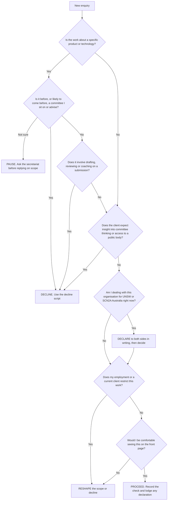
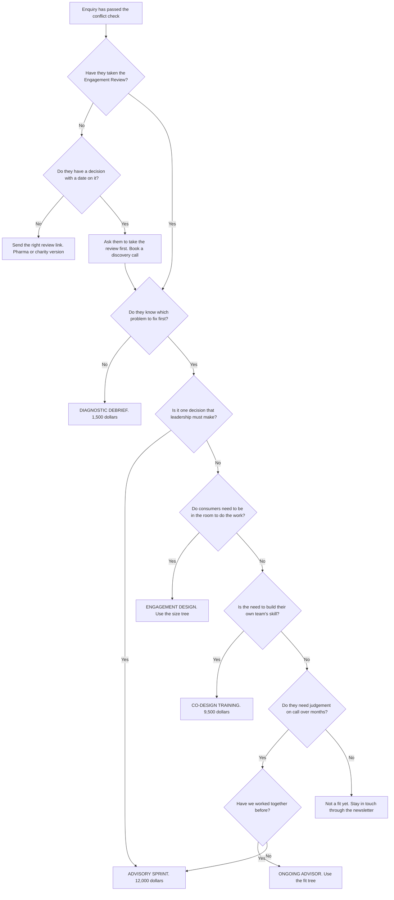
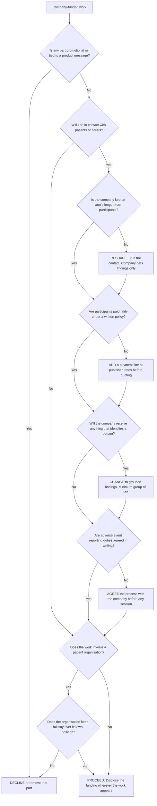
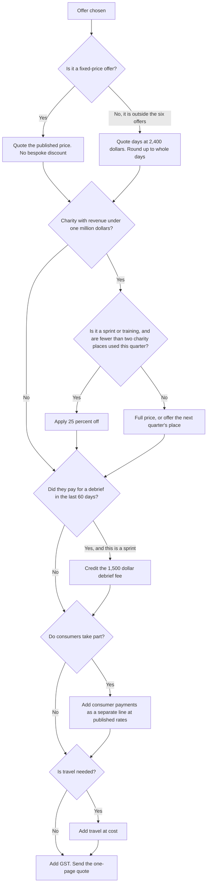

# Decision trees that apply to every offer

Draft for Kris's approval. Four trees, used in this order whenever an enquiry arrives: conflict check, which offer, company work and the Code, price. Each offer folder has its own trees for decisions inside that offer.

Each tree is drawn as a flowchart and then written out as numbered steps, so it works on paper too.

---

## 1. Conflict check: can I take this at all?

Run this before any conversation about scope with a company, and before accepting any paid work from anyone.

In words:

1. Is the work about a specific product or technology? If no, go to step 4.
2. Is that product before, or likely to come before, a committee I sit on or advise? If yes, decline. If I am not sure, pause and ask the committee secretariat before saying anything about scope.
3. Does the work involve drafting, reviewing or coaching on a submission? If yes, decline.
4. Does the client expect insight into how a committee thinks, or access to a public body? If yes, decline.
5. Am I dealing with this organisation for UNSW or SCN2A Australia at the moment? If yes, declare the overlap to both sides in writing before deciding.
6. Does my employment contract or a current client restrict this work? If yes, reshape the scope or decline.
7. Would I be comfortable seeing this engagement reported on a front page? If no, reshape or decline.
8. Otherwise proceed. Record the check in the proposal and lodge any declaration my roles require.

Decline script: "I need to stop you there. I do not work on product-specific submissions, and I cannot discuss how a committee might respond. My government advisory appointments are held independently of this practice. What I can do is help you build the engagement capability and methods behind good work, where they are not tied to a live application. If that is not what you need, I am not the right person, and I would sooner tell you now."

---

## 2. Which offer fits?

In words:

1. Have they taken the Engagement Review? If not, and there is no dated decision, send the right review link (pharmaceutical or charity) and stop there. If there is a dated decision, ask them to take the review and book a discovery call.
2. Do they know which problem to fix first? If not, offer the Diagnostic Debrief.
3. Is it one decision that the leadership team must make? If yes, offer an Advisory Sprint.
4. Do consumers need to be in the room to do the work? If yes, offer Consumer Engagement Design and use the size tree in `04-engagement-design/`.
5. Is the real need to build their own team's skill? If yes, offer the in-house co-design training.
6. Do they need judgement on call over months? If yes and we have worked together before, offer the Ongoing Strategic Advisor and use the fit tree in `05-retained-adviser/`. If we have not worked together, start with a sprint.
7. If none of these, it is not a fit yet. Keep in touch.

Rule of thumb: when unsure between two offers, sell the smaller one. A debrief that leads to a sprint is better than a project that should have been a sprint.

---

## 3. Company work and the Medicines Australia Code

Run this for every piece of work paid for by a pharmaceutical, biotech or medtech company. It sits on top of tree 1.

In words:

1. Is any part of the work promotional or tied to a product message? If yes, decline or remove that part.
2. Will I be in contact with patients or carers? If not, go to step 7.
3. Is the company kept at arm's length from participants? If not, reshape: I run the contact and the company receives findings only.
4. Are participants paid fairly under a written policy? If not, add a payment line at published rates before quoting.
5. Will the company receive anything that could identify a person? If yes, change to grouped findings with a minimum group of ten.
6. Are adverse event reporting duties agreed in writing? If not, agree the process with the company before any session.
7. Does the work involve a patient organisation? If yes, does that organisation keep full say over its own position? If not, decline.
8. Proceed, and disclose the company's funding wherever the work appears.

This tree is a working guide, not legal advice. A lawyer should check the consultancy clause against Edition 20 of the Code before the first company agreement is signed.

---

## 4. Price: what do I quote?

In words:

1. If it is one of the six offers, quote the published price. Do not negotiate a bespoke discount; change the scope instead. If it is outside the six offers, quote whole days at $2,400.
2. If the client is a charity with revenue under $1 million, and the offer is a sprint or training, and fewer than two charity places have been used this quarter, take 25% off. Otherwise quote full price or offer a place next quarter.
3. If the client paid for a debrief in the last 60 days and is now booking a sprint, credit the $1,500.
4. If consumers take part, add their payment as a separate line at published rates. It never comes out of my fee.
5. Add travel at cost if needed.
6. Add GST and send the one-page quote from the offer's folder.

If a client asks for a lower price: remove something from the scope and say what was removed. If nothing can be removed, the price stands.

---

## Where the other trees are

| Offer | Trees in its folder |
|---|---|
| Engagement Review | From a completed review to the next step |
| Diagnostic Debrief | Choosing the three priorities; from debrief to the next step |
| Advisory Sprint | Which of the four sprint types; go or no-go before quoting |
| Engagement Design | Which size; level of involvement; method; consumer payment |
| Ongoing Advisor | Fit and tier; triage of requests; standing conflict check; renewal |
| Co-design training | Format |
