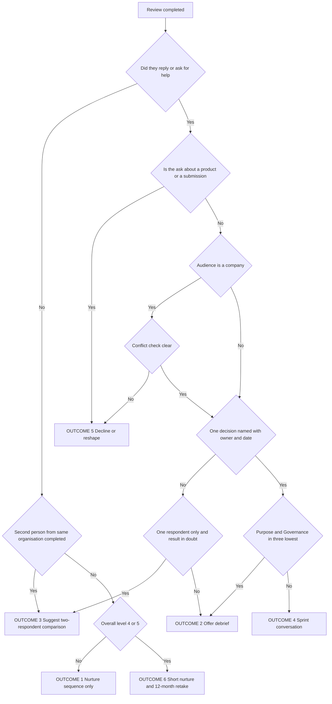

# Engagement Review: result routing decision tree

Internal. From a completed review to the next step. Run it for every completion when the result lands in the results database, and again whenever the person replies. It takes two minutes. Record the outcome in the pipeline tracker (`../../assets/pipeline-tracker.csv`, `next_action`).

What you need in front of you: the audience (`pharma` or `charity`), the overall score and level, the three lowest domains, any reply or request from the person, and whether anyone else from the same organisation has completed the review.

Nothing here is sent without Kris's approval. The nurture sequence is in `../../assets/diagnostic-nurture-sequence.md`. The conflict check is the internal checklist in `../../assets/proposal-template.md`, section 9.

## The tree

## The same logic in plain text

1. Did the person reply, or ask for help in any form (a reply to an email, a booking attempt, a message)?
   - No: go to 2.
   - Yes: go to 4.
2. Has a second person from the same organisation completed the review?
   - Yes: Outcome 3.
   - No: go to 3.
3. Is the overall level 4 (Embedded) or 5 (Community-led)?
   - No (levels 1 to 3): Outcome 1.
   - Yes: Outcome 6.
4. Is the ask about a product, a submission, or how a committee is likely to respond?
   - Yes: Outcome 5.
   - No: go to 5.
5. Is the audience a company (`pharma`)?
   - Yes: go to 6.
   - No: go to 7.
6. Run the conflict flag: does the company have a product or technology that is, or is likely to be, before a committee Kris sits on or advises, and is the ask not clearly separate from it? Is Kris negotiating with this company on behalf of an employer?
   - Not clear on either point: Outcome 5.
   - Clear: go to 7.
7. Have they named one decision, with a person who owns it and a date?
   - No: go to 8.
   - Yes: go to 9.
8. Did only one person answer, and do they doubt the result (they say it is too high, too low, or that colleagues would disagree)?
   - Yes: Outcome 3.
   - No: Outcome 2.
9. Is Purpose and Governance one of the three lowest domains?
   - Yes: Outcome 2. With no one accountable, a sprint has no decision owner to report to. The debrief settles that first.
   - No: Outcome 4.

## Outcomes

**Outcome 1. Send nurture sequence only.** Let the four emails run (day 0, 3, 8 and 15). Add no personal message. Stop the sequence the moment the person books or replies, then run this tree again from step 4. Tracker: stage `diagnostic`, next action "day 8 email".

**Outcome 2. Offer debrief.** Reply personally within two working days. Name their three lowest domains, ask what decision or deadline sits behind their interest, and give the booking link. Use the booking page copy in `../../assets/diagnostic-debrief-offer.md` (c); do not rewrite it. Before accepting the booking, complete `../02-diagnostic-debrief/intake-and-conflict-check-form.md`. If they named a decision, say that the debrief fee is credited against a sprint booked within 60 days.

**Outcome 3. Suggest two-respondent comparison.** Send `two-respondent-comparison-worksheet.md` with a three-line note: two views are more useful than one, here is a way to compare them in 30 minutes, and tell me what the gaps were. If a second person has not yet taken the review, send them the direct link first (`/diagnostic#pharma` or `/diagnostic#charities`). When they come back with the comparison, run the tree again from step 7. If they asked for help, tell them the debrief is the next step once the comparison is done.

**Outcome 4. Go straight to a sprint conversation.** Offer a 30-minute call using `../../assets/discovery-call-guide.md`. Before the call, run `../03-advisory-sprint/sprint-type-decision-tree.md`; before quoting, run `../03-advisory-sprint/scoping-checklist-and-go-no-go.md`. Tell them plainly that a debrief is not needed when the decision, the owner and the date are already clear. No debrief fee credit applies, because no debrief was held.

**Outcome 5. Decline or reshape.** Reply within two working days. If the ask is product-specific (drafting, reviewing or coaching on a submission, or advice on how a committee may respond), decline it in one sentence and say what remains open: work on how the organisation engages, as a capability. If a conflict check is not clear, either reshape the scope so it is clearly separate, declare it where the roles require, or decline. Record the reason and the date in the tracker. Do not refer the product-specific work to anyone.

**Outcome 6. Short nurture and 12-month retake.** Send day 0 and day 3 only. Skip the day 8 and day 15 debrief emails: an organisation at level 4 or 5 rarely needs a debrief, and offering one reads as selling. Diarise a note at 12 months suggesting a retake. If benchmark consent was given, mark the result as a strong example for the annual note, de-identified. [Kris: confirm that high results should skip the debrief emails.]

## Notes

- Charities and community organisations are not sent through the conflict flag at step 6, but every paid booking, for any audience, still gets the full conflict check on the intake form before it is accepted.
- The level and the lowest domains change the route in two places only: steps 3 and 9. Everything else turns on what the person asks for.
- A company at any level that never replies stays in Outcome 1 or 6. Do not chase.
