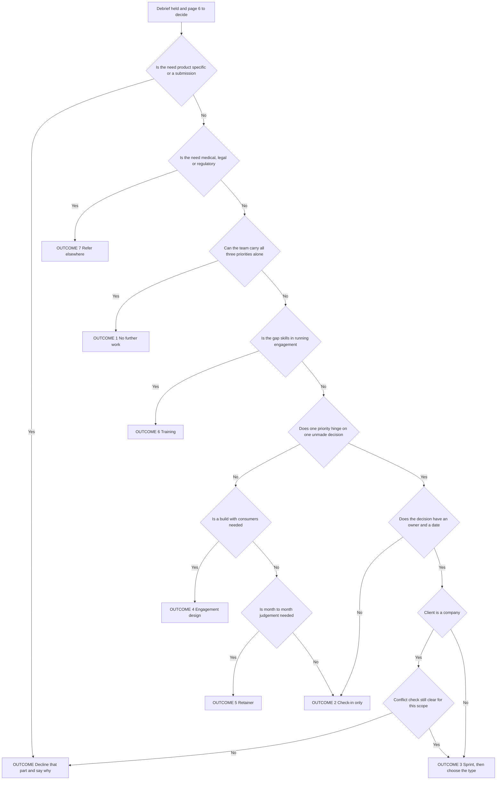

# Diagnostic Debrief: from the debrief to the next step

Internal. Run this in the ten minutes straight after the session, when the page 6 answer is decided (`session-guide.md`, section 6), and again when the client replies to the plan or to the 30-day check-in. It decides what page 6 says under "worth outside help" and what, if anything, is offered.

The honest answer is often "nothing". Target conversion is 1 in 3. Prices and capacity limits are in `../../BRAIN.md`, section 4 and section 5.

Two dates to write down before starting:

- Debrief date: [date]
- Day 60, when the fee credit lapses: [date]. The $1,500 debrief fee is credited against a Strategic Advisory Sprint booked by this date. It is not credited against any other offer.

## The tree

## The same logic in plain text

1. Is what the client needs next product-specific: drafting, reviewing or coaching on a submission, or advice on how a committee may respond?
   - Yes: Outcome "Decline that part". Then continue from step 3 for whatever remains.
   - No: go to 2.
2. Is the need medical, legal or regulatory advice, or something outside consumer and community engagement?
   - Yes: Outcome 7.
   - No: go to 3.
3. Can the team carry all three priorities alone? (The question asked in minutes 80 to 87.)
   - Yes: Outcome 1.
   - No: go to 4.
4. Is the gap a skills gap: staff who will run sessions with community members and have not been shown how?
   - Yes: Outcome 6.
   - No: go to 5.
5. Does one of the three priorities hinge on a single decision nobody has made yet?
   - Yes: go to 8.
   - No: go to 6.
6. Does the client need something built and run with consumers: discovery, co-design sessions, a framework? Or are there several decisions at once?
   - Yes: Outcome 4.
   - No: go to 7.
7. Does the client need judgement month to month while carrying out the plan, with no single decision to settle?
   - Yes: Outcome 5.
   - No: Outcome 2.
8. Does that decision have a named owner and a date by which it must be made?
   - No: Outcome 2.
   - Yes: go to 9.
9. Is the client a company?
   - No: Outcome 3.
   - Yes: go to 10.
10. Run the conflict check again for the sprint scope, not just the debrief (`intake-and-conflict-check-form.md`, part 3, and `../../assets/proposal-template.md`, section 9). Is it still clear, and does the scope sit inside the Medicines Australia Code of Conduct?
    - Yes: Outcome 3.
    - No: Outcome "Decline that part", or reshape the scope until it is clearly separate from any product.

## Outcomes

**Outcome 1. No further work.** Page 6 reads: "Nothing in this plan. Your team can carry all three priorities." Use the "if it does not" paragraph in the plan delivery email (`emails.md`, 3). Send the 30-day check-in without the sprint paragraph. After the one reply, close the tracker row. Ask nothing more.

**Outcome 2. 30-day check-in only.** There may be a decision, but it has no owner or no date yet, or nothing fits today. Page 6 says so in one line and names what would need to be true first. The 30-day check-in asks whether that has changed. If the reply names an owner and a date, run this tree again from step 8. If day 60 passes first, the credit has lapsed; say so if asked, and do not extend it. [Kris: confirm no extensions.]

**Outcome 3. Sprint, and which type.** Page 6 names the one decision as a question and the sprint type. Choose the type with `../03-advisory-sprint/sprint-type-decision-tree.md`: a consumer evidence plan, an engagement strategy, a trial-readiness review or a partnership approach. Add the credit sentence with the day 60 date. Use the "if a sprint fits" paragraph in email 3. Mention the credit once more at day 30, then stop. If the client says yes, run `../03-advisory-sprint/scoping-checklist-and-go-no-go.md` before quoting. Fee: $12,000, less $1,500 if booked by day 60; charity rate if eligible.

**Outcome 4. Consumer Engagement Design.** Page 6 says the next step is larger than a sprint and why: it needs sessions with consumers, or more than one decision. Offer a scoping call using `../../assets/discovery-call-guide.md`. $18,000 to $45,000, with consumer payments at published rates as a separate line. Check capacity first: one project at a time. The debrief fee is not credited.

**Outcome 5. Retainer.** Page 6 says ongoing advice would help and what it would be used for. Check capacity first: no more than two retainers. Describe it in one line: a monthly working session, document review and advice on call, $3,500 or $6,500 a month, six-month minimum. See `../05-retained-adviser/`. For a company, the conflict check and Code clause apply to the retainer scope. The debrief fee is not credited.

**Outcome 6. Training.** Page 6 says the team needs the skill, not a decision. In-house co-design training: one day, up to 12 people, $9,500; charity rate if eligible. See `../06-co-design-training/`. Typical sign: a low result in Engagement Practice, Capability and Culture or Safety, Ethics and Recognition with a willing team. The debrief fee is not credited.

**Outcome 7. Refer elsewhere.** Say plainly that it is outside what I do. For legal or regulatory questions, point the client to their own lawyer or regulatory adviser. For a company's Code questions, to its own compliance team. Name a kind of adviser, not a person, unless Kris knows one and has no interest to declare. [Kris: a short list of people or organisations you are comfortable referring to, if any.] Page 6 records it under "questions for someone else".

**Outcome: decline that part and say why.** One sentence, in the session or in writing: "I do not work on product-specific submissions or advise on how a committee is likely to respond, so I will leave that outside this plan." Do not refer it on. Keep the plan to general engagement capability and record the exchange in the tracker.

## Rules that hold across every outcome

- One offer, named once on page 6 and once in the delivery email. Never two.
- If two outcomes seem to fit, choose the smaller.
- The credit applies only to a sprint, only within 60 days, and is mentioned at most twice: in the plan and at day 30.
- Nothing offered refers to Kris's public appointments.
- If the client asks for a second session or a document review, that is a sprint or the retainer. Do not give it away inside the debrief.
