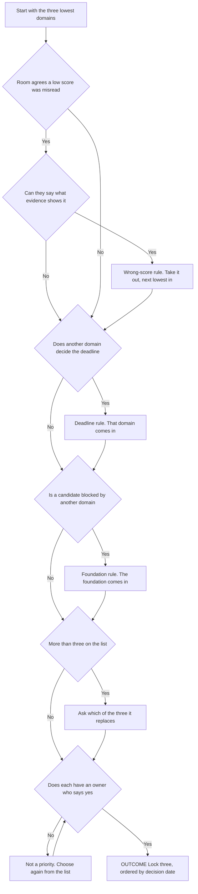
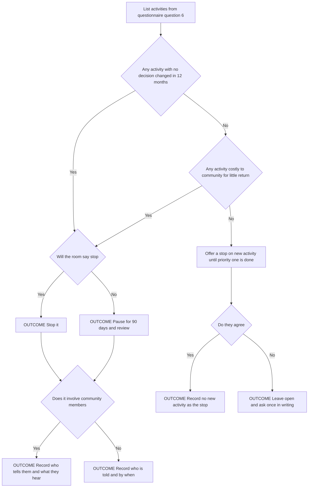

# Diagnostic Debrief: priority decision tree

Internal. Two trees for minutes 25 to 30 and 72 to 80 of the session: choosing the three priorities, and choosing what to stop. They turn the rules in `session-guide.md` (sections 2 and 4) into steps. The rules themselves are unchanged.

Have in front of you: the seven scores, the decision or deadline from the cover block, and questionnaire question 6 with its starred items.

## Tree 1. Choosing the three priorities

The same logic in plain text:

1. Start with the three lowest-scoring domains as the review reports them. Ties go to the earlier domain.
2. Does the room agree that one of the three low scores was a misreading?
   - No: go to 4.
   - Yes: go to 3.
3. Can they say what evidence shows it (a document, a group, a payment made, something that could be shown)?
   - Yes: **the wrong-score rule applies.** That domain goes out and the next lowest comes in. Record the client's reading on page 1 under "what the session changed". Go to 4.
   - No: the score stands. Say: "The score is where the conversation starts. Tell me what I would see if I looked." Go to 4.
4. Does a domain outside the three decide whether the client meets the decision or deadline in the cover block?
   - Yes: **the deadline rule applies.** That domain comes in. It replaces whichever of the three has the least bearing on the deadline; that one goes to "Not now" on page 5. Go to 5.
   - No: go to 5.
5. Is one of the three unable to move until a different domain does? The usual case: Engagement Practice will not hold if nobody is accountable under Purpose and Governance.
   - Yes: **the foundation rule applies.** The foundation comes in. If it is not already one of the three, it replaces the domain that depends on it, which goes to "Not now" with the note "after [foundation domain]". Go to 6.
   - No: go to 6.
6. Are there now more than three on the list, or has the client asked for a fourth?
   - Yes: ask, "Which of the three does it replace?" Hold the line at three. Go to 7.
   - No: go to 7.
7. For each of the three, is there one named person in or known to the room who says yes to owning it?
   - No: it is not a priority. Say: "If nobody owns it, it does not go in the plan. Should it come out?" Take it out, bring in the next lowest domain, and repeat this step. If no decision-maker is present at all, record the owner as "to be confirmed by [name] by [date]" and make confirming owners the first action.
   - Yes for all three: go to the outcome.

**Outcome: lock three.** Order them by the date of the decision each one affects, earliest first, not by score. Say the three aloud, say which rule applied if any did, and get a yes from the decision-maker. Write the titles on pages 2 to 4, each stated as an outcome. Record any swap on page 1 with the rule named: the deadline, the foundation or a misread score. If nothing was swapped, write: "The session confirmed the results as reported."

Notes:

- Apply the rules in this order. A misread score is settled first, because it changes which three the other rules are tested against.
- At most one swap per rule. If all three rules fire, slow down: the scores may reflect one person guessing, and the pass through the domains in minutes 15 to 25 needs another look.
- Which domain goes out under the deadline and foundation rules is my reading of the session guide, which says only what comes in. [Kris: confirm.]

## Tree 2. Choosing what to stop

The same logic in plain text:

1. List the activities from questionnaire question 6, starred items first.
2. Has any of them failed to change a decision in the last 12 months?
   - Yes: it is a candidate. Go to 4.
   - No: go to 3.
3. Does any of them cost the community a lot of time for little return to them?
   - Yes: it is a candidate. Go to 4.
   - No: go to 6.
4. Ask: "If you stopped it tomorrow, who would notice, and what would they lose?" and "What does stopping it free up?" Will the room say "stop"?
   - Yes: **Outcome: stop it.** Record the activity, the reason and what it frees up on page 5. Go to 5.
   - No: **Outcome: pause for 90 days and review.** Record it the same way, with the review date. Go to 5.
5. Do community members take part in the activity?
   - Yes: **Outcome: record who tells them and what they hear.** Stopping is itself a loop to close. They hear first, they hear why, and they hear what replaces it. Draft the wording on page 5.
   - No: **Outcome: record who is told, by whom and by when.**
   - Then return to step 2 for the next candidate, until there are at least one and at most three.
6. Nothing was named. Offer: "Then the thing to stop is starting new engagement activity until priority one is done." Do they agree?
   - Yes: **Outcome: record "no new engagement activity until priority one is done" as the stop.**
   - No: **Outcome: leave page 5 open and ask once in writing.** Do not invent a stop. Put the question in the plan delivery email, and hold the plan until there is an answer, because the quality bar in `PRODUCT.md` section 7 requires at least one real activity the client agreed to stop or pause.

Limits: at least one, at most three. A plan that only adds work will not be carried out.
