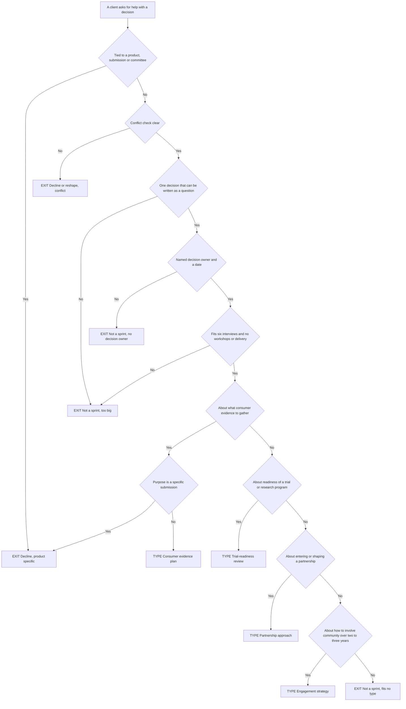

# Strategic Advisory Sprint: sprint type decision tree

Internal. Use it after a debrief names a decision, or after a discovery call, and before the scoping checklist (`scoping-checklist-and-go-no-go.md`). It answers two questions: is this a sprint at all, and if so which of the four types. The types themselves are defined in `PRODUCT.md`, section 5, and are not repeated here.

Every sprint is one of the four. If the work does not fit one of them, it is not a sprint.

## The tree

## The same logic in plain text

1. Is the request tied to a product, a submission, or how a committee may respond? That includes drafting, reviewing or coaching on a sponsor's submission.
   - Yes: Exit "Decline: product-specific".
   - No: go to 2.
2. Is the conflict check clear? Use the internal checklist in `../../assets/proposal-template.md`, section 9: nothing before, or likely to be before, a committee Kris sits on or advises that the scope is not clearly separate from; no negotiation under way with this organisation on behalf of an employer without a declaration to both sides.
   - No: Exit "Decline or reshape: conflict".
   - Yes: go to 3.
3. Is there one decision, and can it be written as a single question the leadership team has to answer?
   - No (several decisions, or none yet): Exit "Not a sprint: too big".
   - Yes: go to 4.
4. Is there a named decision owner, and a date by which the decision must be made?
   - No: Exit "Not a sprint: no decision owner".
   - Yes: go to 5.
5. Can it be done inside the sprint's limits: up to 15 documents, up to six interviews, no workshops, surveys or co-design sessions, and no carrying out of the recommendation?
   - No: Exit "Not a sprint: too big".
   - Yes: go to 6.
6. Is the decision about what evidence of consumer experience and preference to gather, by what methods, and at what cost?
   - Yes: go to 7.
   - No: go to 8.
7. Is the client's purpose a specific submission, live or likely?
   - Yes: Exit "Decline: product-specific". Reshape only if the client genuinely wants general evidence capability with no tie to an application.
   - No: Type 1, consumer evidence plan.
8. Is the decision about whether consumer involvement in a trial or research program is ready for funders, ethics reviewers and participants by a date?
   - Yes: Type 3, trial-readiness review.
   - No: go to 9.
9. Is the decision about whether to enter a partnership, or a kind of partnership, and on what terms?
   - Yes: Type 4, partnership approach.
   - No: go to 10.
10. Is the decision about how the organisation involves its community over the next two to three years, who is accountable and what it will fund?
    - Yes: Type 2, engagement strategy.
    - No: Exit "Not a sprint: fits no type".

## Types: what to do next

**Type 1. Consumer evidence plan.** Name the type in the quote and the proposal. Write the guardrail into the scope: methods and capability only, never tied to a live or likely application. At kickoff, tell interviewees that no specific application will be discussed. Then run the scoping checklist.

**Type 2. Engagement strategy.** Name the type. Ask for the review results and the debrief action plan if there are any; they shorten week 1. The paper ends at the decision and the first 30 days: strategy, not delivery. Then run the scoping checklist. For a company, this is the usual first sprint (an engagement strategy for the affiliate, a payment and independence policy, or a standing patient panel).

**Type 3. Trial-readiness review.** Name the type. Confirm in writing that the review covers consumer involvement in research design and conduct only: it is not scientific, regulatory or reimbursement advice. Ask for the funder's published requirements. Then run the scoping checklist.

**Type 4. Partnership approach.** Name the type. Before proposing, check whether Kris is negotiating with either party on behalf of an employer; if so, declare to both sides first. Do not interview the counterparty in a live negotiation unless both sides agree. For a company, the Medicines Australia Code clause in the proposal applies, and no access to any public body is offered or implied. Then run the scoping checklist.

## Exits: what to do next

**Exit. Not a sprint: too big (becomes engagement design).** Say: "This is more than one decision, or it needs sessions with your community, so a sprint would short-change it." Offer a scoping call for Consumer Engagement Design ($18,000 to $45,000, consumer payments as a separate line; see `../04-engagement-design/`). Check capacity: one project at a time. If the client has not had a debrief and has several loose decisions, offer the debrief first; it will usually reduce them to one.

**Exit. Not a sprint: no decision owner.** Say: "A sprint ends with someone deciding. Until there is a name and a date, I would be writing a paper for nobody." Ask who would decide and by when. If they come back with both, start again at step 5. If not, offer a Diagnostic Debrief, where naming an owner is part of the work, or leave it. Do not quote.

**Exit. Decline: product-specific.** Reply in two sentences: "I do not work on product-specific submissions: no drafting, reviewing or coaching, and no advice on how a committee may respond. If you want help with how your organisation engages, as a capability and separate from any application, I can do that." Do not refer the work on. Record in the tracker.

**Exit. Decline or reshape: conflict.** If the scope can be made clearly separate, rewrite the decision question, show the client the change, and return to step 3. If a declaration resolves it, lodge it first. If neither, decline with the wording in `../02-diagnostic-debrief/intake-and-conflict-check-form.md`, part 5. The client pays nothing for work not started.

**Exit. Not a sprint: fits no type.** Ask the client to state the decision again as a question. If it still fits none of the four, it may be an Alignment Program, training or a retainer question; see `../../BRAIN.md`, section 4. Do not invent a fifth sprint type.

## Tie-breaks

- A decision that touches two types takes the type of the question the decision owner must answer first. Example: "should we partner, and what evidence would we gather together" is a partnership approach; the evidence question waits.
- A company asking how to work with patient organisations in general, with no named partner, is an engagement strategy, not a partnership approach.
- A research team asking about a consumer evidence stream inside a trial is a trial-readiness review if a funding or ethics date drives it, and a consumer evidence plan if not.
