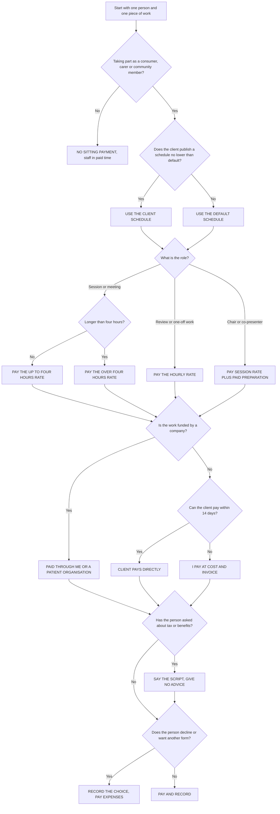

# Consumer payment decision tree and payment record

> **What this is:** whether and how to pay a consumer, carer or community member for any piece of work I design or run, and the record kept of every payment. Internal. It applies the payment rules in `consumer-recruitment-and-payment-kit.md`, section 4; it does not change them.
> **The short answer:** always recognise people's time. The offer of payment is made every time, at a published rate, as a separate cost line. It is never taken from my fee.
> **Not advice:** I do not give tax, income support or financial advice to participants. I tell them a payment may matter for those things and that they should seek their own advice.

## Published rates I may cite

These are the only figures used. Each was taken from a search summary recorded in `../../../research/01-ai-and-consulting-market.md`, not from the primary document. Check the primary source before quoting any figure to a client or a participant; rates are revised from time to time.

| Schedule (name it in the proposal) | Published rate | How I apply it |
|---|---|---|
| **Default:** Health Consumers Queensland, Remuneration and Reimbursement of Consumers Position Statement, rates from 1 July 2024 | $234 per meeting of up to four hours; $469 per meeting of more than four hours; $50 an hour for one-off work | Sessions and meetings by length; review, pre-reading over 30 minutes and other one-off work by the hour |
| NSW Health | $40 an hour; $60 an hour for chairing | Only where the client already uses it and the total is not lower than the default for the same time |
| Monash Partners (2022, may be dated) | Member $55 an hour; chair $60 an hour | As above |
| Safer Care Victoria, A guide to consumer remuneration (December 2024) | Rates not recorded in my research notes | Read the guide before citing |

These are floors for lay consumers. They are not consultant rates and not my fee.

## The tree

## The same logic as a list

1. **Is the person taking part as a consumer, carer or community member, not as paid staff doing their job?** If they are staff in paid time: **NO SITTING PAYMENT**. Community members who hold standing roles with the organisation (an advisory group chair, a consumer board member) are paid as community members. If yes: go to 2.
2. **Does the client already publish its own schedule, and is it no lower than the default for the same time?** If yes: **USE THE CLIENT SCHEDULE**. If no, or the client has none: **USE THE DEFAULT SCHEDULE** (Health Consumers Queensland). Name the schedule in the proposal either way. Go to 3.
3. **What is the role, and how long is it?**
   - A session or meeting of up to four hours: **PAY THE UP TO FOUR HOURS RATE** ($234 at the default).
   - A session or meeting of more than four hours: **PAY THE OVER FOUR HOURS RATE** ($469 at the default).
   - Reviewing a document, pre-reading over 30 minutes, or other one-off work: **PAY THE HOURLY RATE** ($50 an hour at the default).
   - Chairing a group, or co-presenting a training session: **PAY SESSION RATE PLUS PAID PREPARATION**.
   Go to 4.
4. **Is the work funded by a pharmaceutical, biotech or medical technology company?** If yes: **PAID THROUGH ME OR A PATIENT ORGANISATION**, never by the company directly. If no: go to 5. Then go to 6.
5. **Can the client pay each person within 14 days of the session?** If yes: **CLIENT PAYS DIRECTLY**. If no: **I PAY AT COST AND INVOICE**, with no margin. Go to 6.
6. **Has the person asked about tax, Centrelink, the NDIS or any other benefit?** If yes: **SAY THE SCRIPT, GIVE NO ADVICE**. Go to 7 either way.
7. **Does the person decline payment, or ask for it in another form?** If yes: **RECORD THE CHOICE, PAY EXPENSES**. If no: **PAY AND RECORD**.

## Named outcomes: what I do

| Outcome | What I do |
|---|---|
| **NO SITTING PAYMENT, staff in paid time** | No sitting payment. Note in the session record that the person attended as staff. If a staff member is also taking part as a carer or patient in their own time, treat them as a community member and go back to step 2. |
| **USE THE CLIENT SCHEDULE** | Name the client's schedule and its date in section 7 of the proposal. Check the total is not lower than the default for the same time; if it is, use the default. |
| **USE THE DEFAULT SCHEDULE** | Name "Health Consumers Queensland, Remuneration and Reimbursement of Consumers Position Statement (rates from 1 July 2024)" in section 7 of the proposal. Check the current published figures first. |
| **PAY THE UP TO FOUR HOURS RATE** | One payment per session attended, in full, including if the person leaves early, and if a confirmed session is cancelled with less than 48 hours' notice. |
| **PAY THE OVER FOUR HOURS RATE** | Used for a full training day or a meeting over four hours. No co-design session in this product runs over four hours. |
| **PAY THE HOURLY RATE** | Pay by the hour for review and other one-off work. The standard allowance is 1 hour for checking the report back. Pre-reading of 30 minutes or less is treated as part of the session. |
| **PAY SESSION RATE PLUS PAID PREPARATION** | Pay the session or meeting rate for the time in the room, and the hourly rate for agreed preparation. A chair or co-presenter does skilled work, and the published figures are floors. [Kris: set the rate for chairs and co-presenters. The published chair rates in my research notes are NSW Health at $60 an hour and Monash Partners at $60 an hour (2022); no chair rate is recorded there for Health Consumers Queensland.] |
| **PAID THROUGH ME OR A PATIENT ORGANISATION** | Participants are paid by Kris Pierce Consulting at cost with no margin, or by the independent patient organisation that recruited them. The company holds no individual payment records and is invoiced one total. Participants are told in plain words who is funding the work before they agree. Payments are for time given, at fair market value, and are not connected to any product. [Kris: confirm with accountant how pass-through payments are handled. Lawyer to confirm against the current Medicines Australia Code of Conduct.] |
| **CLIENT PAYS DIRECTLY** | Agree the route at decision point 1, before recruitment opens. The client collects bank details through its own secure process. I send the client participant names for payment only where the participant has agreed and the client is not a company. |
| **I PAY AT COST AND INVOICE** | I pay within 14 days and invoice the client the exact total, itemised by participant code, with no margin. |
| **SAY THE SCRIPT, GIVE NO ADVICE** | Use the script below. Do not estimate an effect, name a threshold or suggest how to describe the payment. |
| **RECORD THE CHOICE, PAY EXPENSES** | The choice is the participant's. Options I can offer: decline the payment; receive part of it; receive it later; receive it by another method; receive a voucher, only if the person asks for one. Record that the offer was made and what was chosen. Expenses are still reimbursed at cost. Ask again at the next session; a choice made once is not a standing choice. |
| **PAY AND RECORD** | Trigger payment within 2 working days of the session; paid within 14 days; one line in the payment record. Expenses (travel, parking, care costs, data, access needs) reimbursed at cost on top. |

## The script for tax and benefit questions

Said or written, word for word:

> "A payment like this may count as income for tax or for income support payments. I am not able to give advice on that, and I would not want to guess. If it matters for you, please check with the agency that pays you, or with your own adviser, before you decide. Whatever you choose is fine with me: you can take the payment, take part of it, take it another way, or decline it. Your place in the sessions is not affected."

What I do not do: tell anyone what a payment will or will not do to their tax or benefits; suggest splitting, relabelling or timing a payment to change how it is treated; fill in any form for a participant. [Lawyer to confirm the wording.]

## Checks every time

- [ ] Payment is a separate line in the proposal (section 7), with the schedule named.
- [ ] The payment route is agreed before recruitment opens.
- [ ] Every participant has been told the amount, who pays, and by when, in writing.
- [ ] Every participant has been told the payment may affect tax or income support, and offered the choice to decline or vary it.
- [ ] Bank details are collected once, stored apart from session notes, and deleted when the last payment clears.
- [ ] Company clients: the company sees one total and no names.

---

## Payment record template

One row per payment. Kept by me, or by the client's payments lead where the client pays directly. Participant codes only; the key linking codes to names is stored separately and deleted on the date promised in the information sheet. Anything shared with a client uses codes. A company client receives the totals row only.

**Project:** [name]. **Client:** [organisation]. **Schedule used:** [name and date of the published schedule; date I checked the primary source: date]. **Paid by:** [client / Kris Pierce Consulting at cost / independent patient organisation: name].

| Participant code | Role | Activity | Date of activity | Hours | Rate applied | Sitting payment | Expenses at cost (what for) | Total | Offer made (date) | Participant's choice | Method | Due by (14 days) | Date paid | Paid by | Notes |
|---|---|---|---|---|---|---|---|---|---|---|---|---|---|---|---|
| EXAMPLE P1 (delete before use) | Participant | Session 1 | [date] | 2 | Up to four hours | $234 | $[amount] ([parking]) | $[amount] | [date] | Accepted | Bank transfer | [date] | [date] | [who] | |
| EXAMPLE P2 (delete before use) | Participant | Review of report back | [date] | 1 | One-off work, per hour | $50 | $0 | $50 | [date] | Declined; offer recorded | Not applicable | Not applicable | Not applicable | Not applicable | Ask again at the next activity |
| [code] | [role] | [activity] | [date] | [hours] | [rate name] | $[amount] | $[amount] ([what for]) | $[amount] | [date] | [accepted / varied: how / declined] | [method] | [date] | [date] | [who] | [text] |
| **Totals** | | | | | | **$[amount]** | **$[amount]** | **$[amount]** | | | | | | | |

**Reconciliation at close-out**

| Check | Result |
|---|---|
| Total paid matches the consumer payments line in the proposal, or the difference is explained | [text] |
| Every payment made within 14 days; any late payment, with the reason and what was done | [text] |
| Every participant offered payment for every activity | [yes / no: text] |
| Bank details deleted on | [date] |
| Key to participant codes deleted on | [date] |
