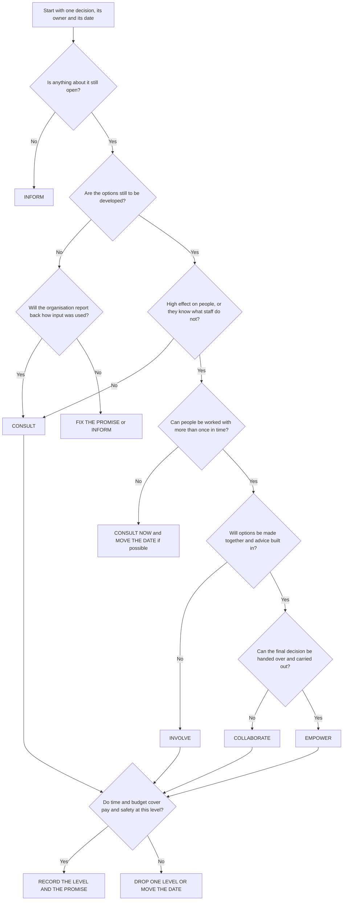

# Level of involvement decision tree

> **What this is:** for any one decision, the level of involvement it warrants: inform, consult, involve, collaborate or empower. It answers the CEOF Engagement Practice question: what decision is this, and what involvement does it warrant?
> **When to use it:** in Discovery when building the decision inventory; at decision point 1 with the decision owner; when filling the decision table in section 3 of `engagement-framework-template.md`. In session 2, participants place the same decisions themselves. The two answers are then compared.
> **Source of the levels:** the IAP2 Spectrum of Public Participation, published by the International Association for Public Participation. The descriptions below are in my own words; see IAP2 for the original.

## The five levels and the promise each one makes

| Level | Plain words | What it is | The promise to participants |
|---|---|---|---|
| **Inform** | Told | Balanced information so people understand the issue, the options or the decision. Information goes one way. | "You will be told what was decided and why." |
| **Consult** | Asked | People give feedback on analysis, options or a draft. The organisation still shapes the options and decides. | "Your views will be heard, and you will be told how they affected the decision." |
| **Involve** | Worked with | People are worked with more than once through the process, so their concerns and hopes are understood and considered. | "Your concerns will be reflected in the options, and you will be shown how." |
| **Collaborate** | Deciding together | People are partners in each part of the decision, including developing the options and choosing the preferred one. | "Your advice will be built into the decision as far as possible." |
| **Empower** | Deciding | The final decision is in people's hands. | "What you decide will be carried out." |

Three rules that sit over the tree:

1. No level is better in itself. The right level depends on the decision.
2. One project can hold several decisions at different levels. Run the tree once for each decision.
3. The failure is promising one level and delivering a lower one. Choose the highest level whose promise the organisation can keep.

## The three things the tree tests

| Test | Question | Evidence to ask for |
|---|---|---|
| Effect | How much does this decision change people's lives, care or costs? | Who is affected, how many, how seriously |
| Openness | What can still change: the problem, the options, the choice, or only the detail? | The "not open to influence" list from decision point 1 |
| Promise | What can the organisation honestly promise and keep? | Who holds the decision, any legal or funding limit, time and budget for pay and safety |

## The tree

## The same logic as a list

1. **Is anything about this decision still open?** If it is already made, or fixed by law, funding rules or safety requirements: **INFORM**. Say so plainly. Telling people the truth about a closed decision is acceptable; asking for views on it is not. If something is open: go to 2.
2. **Are the options still to be developed, or do finished options or a draft already exist?** If the options exist and only the choice or the detail is open: go to 3. If the options are still to be developed: go to 4.
3. **Will the organisation report back how the input affected the decision?** If yes: **CONSULT**, then go to 8. If no: **FIX THE PROMISE or INFORM**. Either the decision owner commits to the report back in writing, or the activity is described as informing and no views are sought.
4. **Is the effect on people's lives, care or costs high, or do community members know something about this that staff do not?** If neither: **CONSULT**, then go to 8. If either: go to 5.
5. **Can people be worked with more than once before the options are set, inside the time available?** If no: **CONSULT NOW and MOVE THE DATE if possible**. If yes: go to 6.
6. **Is the organisation prepared to develop the options together with community members and build their advice into the decision as far as possible?** If no: **INVOLVE**, then go to 8. If yes: go to 7.
7. **Can the organisation hand over the final decision and carry out what is decided, in law and in fact?** The test is whether the organisation could overrule the result. If it could: **COLLABORATE**. If it could not, and will not: **EMPOWER**. Then go to 8.
8. **Do time and budget cover payment at published rates and the safety provisions this level needs?** If yes: **RECORD THE LEVEL AND THE PROMISE**. If no: **DROP ONE LEVEL OR MOVE THE DATE**. Pay and safety are never cut to hold a level.

## Named outcomes: what I do

| Outcome | What I do |
|---|---|
| **INFORM** | Enter "Inform" in the decision table. Write the reason nothing is open. Take the decision out of the co-design sessions and put it on the "not open to influence" list read out at the start of session 1. |
| **CONSULT** | Enter "Consult". Write what is open (the choice, the detail) and the report-back date. Choose the method with `method-selection-decision-tree.md`. Do not call it co-design. |
| **INVOLVE** | Enter "Involve". The calendar must show at least two points of contact before the options are set, and a record of each concern and how it was dealt with. |
| **COLLABORATE** | Enter "Collaborate". The decision owner, or someone with their authority, takes part in making the options. This is the level where co-design sits. For company clients, consumer sessions stay independent and I carry the options between the groups (see the company note below). |
| **EMPOWER** | Enter "Empower" only with written confirmation from the accountable executive or board that the result will be carried out and cannot be overruled. If that confirmation does not arrive, the level is Collaborate. |
| **FIX THE PROMISE or INFORM** | Ask the decision owner one question: "Will you tell people in writing how their input affected the decision?" A yes, with a date, makes it Consult. Anything else makes it Inform, and I say so. |
| **CONSULT NOW and MOVE THE DATE if possible** | Tell the decision owner the decision warrants more than the timetable allows. Ask once whether the date can move. If it can, re-run from step 5. If not, record Consult, and record in the last column of the decision table why the level is lower than the decision warrants. |
| **RECORD THE LEVEL AND THE PROMISE** | Fill the row in section 3 of the framework: decision, owner, date, level now, level agreed, method, and the promise in words that could be said to a participant. |
| **DROP ONE LEVEL OR MOVE THE DATE** | Go down one level, or change the timetable, and record which. Tell participants the level honestly. |

## When participants ask for a higher level than the organisation agrees

This comes out of session 2 and decision point 3. I do not settle it. I record both positions in the decision table: the level participants asked for, the level agreed, and the organisation's reason in the last column. The reason goes into the report back under "what we will not do and why". If a reason cannot be said to participants, it is not yet a reason.

## Company clients

The level describes influence over the company's general engagement approach, never over a product or an application. Consumer contact stays at arm's length: I, or an independent patient organisation, run the sessions, and company staff do not attend. At Collaborate, options move between the consumer group and the company through me, as themes, with no names. Empower is rare for a company and needs legal confirmation that the hand-over sits inside the Medicines Australia Code of Conduct. [Lawyer to confirm before first use.]
