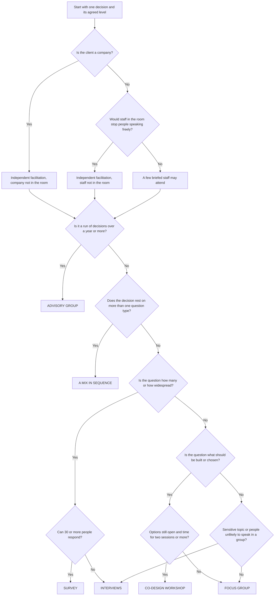

# Method selection decision tree

> **What this is:** how I choose between a survey, interviews, a focus group, a co-design workshop, an advisory group or a mix, for one decision. Internal.
> **When to use it:** after the level is set with `level-of-involvement-decision-tree.md`, when filling the "Method" column of the decision table and the calendar in `engagement-framework-template.md`. The level comes first. A method does not make a level: a workshop that changes nothing is still Inform.
> **Limit:** the three fixed sizes include discovery interviews with staff and the co-design sessions in `co-design-session-plans.md`. Any other method here is one I recommend for the organisation to run after handover, or one added by a written change (`change-request-template.md`).

## The methods in one table

| Method | Answers | Numbers | Usual level | Not suited to |
|---|---|---|---|---|
| Survey | How many, how often, how widespread | 30 or more responses before counts mean anything | Consult | Why something happens; sensitive experience; small communities where people can be recognised |
| Interviews, one to one | What it is like, and why | 6 to 12 people | Consult or Involve | Choosing between options as a group |
| Focus group | Reactions to something that exists: a draft, a set of options | 4 to 8 people a group | Consult | Sensitive topics; people who will not speak freely in front of each other |
| Co-design workshop | What should be built or chosen, made together | 4 to 8 people a group, more than one session | Collaborate, sometimes Empower | Decisions that are already made; a single meeting |
| Advisory group | A run of decisions over a year or more | 6 to 10 members with terms of reference | Involve or Collaborate, depending on the say it holds | One decision with a date |
| A mix | More than one of the questions above | As above for each part | As above for each part | A small budget that would spread each part too thin |

Whatever the method: people are paid at a published rate as a separate cost line, told what is and is not open, and told afterwards what happened to their input.

## The four things the tree tests

1. **Question type:** how many, what is it like, what should be chosen or built, or a run of decisions over time.
2. **Sensitivity:** would people be describing hard or private experience, or criticising a service they still depend on?
3. **Numbers:** how many people can realistically be reached and paid.
4. **Who can be in the room:** whether the client's staff being present would stop people speaking freely. For company clients this is settled in advance: facilitation is independent and company staff are not in the room.

## The tree

## The same logic as a list

1. **Is the client a pharmaceutical, biotech or medical technology company?** If yes: facilitation is independent and the company is not in the room. That is fixed; go to 3. If no: go to 2.
2. **Would the client's staff being in the room stop people speaking freely?** Signs: people will be describing poor care or a complaint; staff hold power over participants' care, funding or membership; the topic has caused conflict before. If yes: independent facilitation, staff not in the room. If no: up to two briefed staff may attend, fewer than the number of community members, and they do not correct or defend. Go to 3.
3. **Is this a run of decisions over a year or more, not one decision?** If yes: **ADVISORY GROUP**. If no: go to 4.
4. **Does the decision rest on more than one type of question?** For example: how widespread a problem is, and what to build in response. If yes: **A MIX IN SEQUENCE**. If no: go to 5.
5. **Is the question how many, how often or how widespread?** If yes: go to 6. If no: go to 7.
6. **Can 30 or more people realistically respond?** If yes: **SURVEY**. If no: **INTERVIEWS**, and report in words ("most", "some"), not percentages.
7. **Is the question what should be built or chosen?** If yes: go to 8. If no (the question is what something is like, or why it happens): go to 9.
8. **Are the options still open, and is there time for at least two sessions with the same people?** If yes: **CO-DESIGN WORKSHOP**. If no: **FOCUS GROUP** on the draft or the options, described honestly as consulting.
9. **Is the topic sensitive, or are these people unlikely to speak freely in a group?** If yes: **INTERVIEWS**. If no: **FOCUS GROUP**.

## Named outcomes: what I do

| Outcome | What I do |
|---|---|
| **SURVEY** | Enter "Survey" against the decision. Keep it to 10 questions or fewer, with at least one open question. Pay or recognise respondents: for a short anonymous survey, state the recognition in the invitation and budget it as a separate line. [Kris: decide the standard recognition for short surveys; no published rate for this is recorded in my research notes.] Report in aggregate only. For company clients, no result is reported for a group smaller than ten. If the results are to be published as research, the client obtains ethics approval first. |
| **INTERVIEWS** | Enter "Interviews, one to one". 6 to 12 people, 45 to 60 minutes each, by phone or video at a time they choose, with the information sheet and consent from `consumer-recruitment-and-payment-kit.md`. Pay each person under the published schedule. Offer a support person. Follow up within 24 hours. |
| **FOCUS GROUP** | Enter "Focus group". 4 to 8 people, 2 hours, two people running it. Use it to test something that exists. State what is open and what is not at the start. Do not describe it as co-design in any document. |
| **CO-DESIGN WORKSHOP** | Enter "Co-design workshops". Use the session plans in `co-design-session-plans.md`: the same group, more than once, with the decision owner's answers carried back between sessions. If the project is inside one of the three sizes, this is the method already included. |
| **ADVISORY GROUP** | Enter "Advisory group" and write it into section 2 of the framework: number, term, how members are chosen, the decisions on its agenda, and the level it works at. An advisory group that only hears updates is Inform, and the framework says so. Suggest the CEOF first move for Voice and Representation: one small group, clear terms of reference, one real decision on its agenda. |
| **A MIX IN SEQUENCE** | Order the parts so each feeds the next: first understand (interviews, or a survey where numbers allow), then build (co-design workshops), then oversee (advisory group). Enter each part as its own row in the calendar with its own report-back date. Cost each part separately. If the mix does not fit the size quoted, raise a written change or park the extra part in the first-year plan. |
| **Independent facilitation, company not in the room** | Recruitment runs through me or an independent patient organisation. Company staff do not attend, and receive no names, contact details, recordings or transcripts. Findings go to the company as themes. No product is named. Participants are told who is funding the work before they agree. |
| **Independent facilitation, staff not in the room** | I facilitate with a second person who is not a senior staff member of the client. The decision owner hears the themes at the midpoint check, with no names attached. |
| **A few briefed staff may attend** | Up to two staff, briefed in writing beforehand: listen, do not correct, do not defend, do not take notes on individuals. In a co-design workshop at Collaborate, the decision owner or their delegate takes part in making the options. |

## Checks before the method goes into the framework

- [ ] The method matches the level already agreed for the decision.
- [ ] The numbers are realistic for this community, and the payment line is costed.
- [ ] Sensitive topics are not put to a group.
- [ ] Company clients: independent facilitation, arm's length recruitment, themes only, no product named.
- [ ] A report-back date is set for the method chosen.
