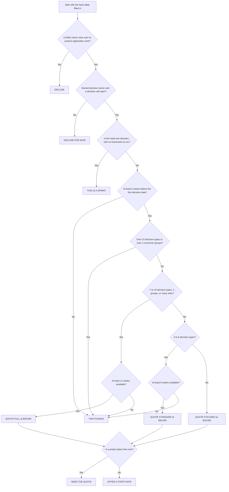

# Consumer Engagement Design: size decision tree

> **What this is:** how I choose Focused ($18,000), Standard ($30,000) or Full ($45,000) from the facts of the job, and when the honest answer is something else. Internal. It applies section 3 of `PRODUCT.md`; it does not change it.
> **When to use it:** after the discovery call (`../../assets/discovery-call-guide.md`) and before the quote. Run the conflict check first.

## The facts to collect before using the tree

| Fact | Where it comes from | Write it here |
|---|---|---|
| Number of decision types in scope in the next 12 months | Discovery call, question on decisions | [number] |
| Number of programs, projects or grants covered | Discovery call | [number] |
| Number of separate consumer groups that must be heard apart (for example: people living with the condition, and parents and carers) | Discovery call | [1 / 2 / more] |
| Number of sites or partner organisations whose decisions the framework must cover | Discovery call | [number] |
| Date the first decision is needed | Decision owner | [date] |
| Weeks from a realistic start to that date | Calendar | [number] |
| Named decision owner | Discovery call | [name, role, or "none"] |

Fixed limits, from `PRODUCT.md` section 3:

| | Focused | Standard | Full |
|---|---|---|---|
| Fee | $18,000 | $30,000 | $45,000 |
| Decision types | Up to 3 | Up to 6 | Up to 10 |
| Consumer participants | 6, one group | 8, one group | 16, two groups of 8 |
| Scope | One program, project or grant | One organisation or one major program | Whole organisation, or multi-site or multi-partner |
| Elapsed time | 6 weeks | 8 weeks | 12 weeks |

Consumer payments are a separate line on top of every fee (`consumer-payment-decision-tree.md`).

## The tree

## The same logic as a list

1. **Is the conflict check clear, and is the work free of product-specific application work?** Run the internal checklist in `../../assets/proposal-template.md`, section 9. If the client wants consumer input for a specific product application, or the work cannot be kept clearly separate from an application that is, or is likely to be, before a committee I sit on or advise: go to **DECLINE**. Otherwise go to 2.
2. **Is there a named decision owner, and is at least one decision still open to influence?** If no: go to **DECLINE FOR NOW**. If yes: go to 3.
3. **Is the need one decision with a date, with no framework for the organisation to run afterwards?** If yes: go to **THIS IS A SPRINT**. If no: go to 4.
4. **Are there at least 6 weeks between a realistic start and the date the first decision is needed?** Recruitment alone needs three weeks. If no: go to **TWO PHASES**. If yes: go to 5.
5. **Are there more than 10 decision types, or more than two consumer groups that must be heard separately?** If yes: go to **TWO PHASES**. If no: go to 6.
6. **Is any one of these true: 7 to 10 decision types; two consumer groups; more than one site or partner organisation whose decisions the framework must cover?** If yes: go to 7. If no: go to 8.
7. **Are at least 12 weeks available?** If yes: **QUOTE FULL**. If no: go to **TWO PHASES**.
8. **Are there 4 to 6 decision types?** If yes: go to 9. If no (1 to 3 decision types, one group, one program, project or grant): **QUOTE FOCUSED**.
9. **Are at least 8 weeks available?** If yes: **QUOTE STANDARD**. If no: go to **TWO PHASES**.
10. **Before any quote goes out: is a project place free?** The capacity rule is one project at a time alongside no more than two retainers. If yes: **SEND THE QUOTE**. If no: **OFFER A START DATE**.

If the facts sit between two sizes, quote the larger one. Sizes are never blended (`PRODUCT.md`, section 3).

## Named outcomes: what I do

| Outcome | What I do |
|---|---|
| **QUOTE FOCUSED** | Fill in `one-page-quote-template.md` with the Focused block: $18,000, 8 days, 6 weeks, 6 participants, 2 sessions, up to 3 decision types. Consumer line at the default schedule: $3,108 before expenses. Then the full proposal. |
| **QUOTE STANDARD** | Standard block: $30,000, 12 days, 8 weeks, 8 participants, 3 sessions, up to 6 decision types. Consumer line: $6,016 before expenses. |
| **QUOTE FULL** | Full block: $45,000, 18 days, 12 weeks, 16 participants in two groups, 6 sessions, up to 10 decision types. Consumer line: $12,032 before expenses. |
| **THIS IS A SPRINT** | Do not quote a design project. Quote the Strategic Advisory Sprint ($12,000, four weeks, one decision) from `../03-advisory-sprint/`. Say why: "You have one decision to make, not a framework to build. A sprint is the right size, and it costs less." |
| **TWO PHASES** | Quote two fixed sizes in sequence, each with its own fee, dates and consumer line. Never a blended price. Phase 1 covers the decisions due first, sized by this tree on those decisions alone (often Focused). Phase 2 is quoted now as an indication and confirmed at the phase 1 handover. If the first decision is under 6 weeks away, phase 1 is a sprint on that decision and phase 2 is the design project. If the limits are exceeded (more than 10 decision types, or more than two groups), phase 1 is the size that fits the first set and phase 2 covers the rest. |
| **DECLINE FOR NOW** | No decision owner, or nothing open to influence. Say so plainly and offer the CEOF Diagnostic (free) and a Diagnostic Debrief ($1,500) to find the decisions and the owner. Set a date to talk again. Record it in the pipeline tracker. |
| **DECLINE** | A conflict, product-specific application work, or a client who wants a consultation report to file. Decline in writing the same day, in two or three sentences, without detail about my other roles beyond the independence line. Record the conflict check in the pipeline tracker. |
| **OFFER A START DATE** | Send the quote with the first available start date. Do not take a second project to keep a client. If demand continues, the price goes up before days are added (`../../BRAIN.md`, section 5). |
| **SEND THE QUOTE** | Send `one-page-quote-template.md`, completed, for Kris's approval first; follow with the full proposal from `../../assets/proposal-template.md`. |

## Three checks before the quote leaves

- [ ] The size matches the tree, and the facts table is saved in the client folder.
- [ ] The consumer payment line is separate and names the published schedule.
- [ ] If the client intends to publish findings as research, the quote says the client obtains ethics approval and the dates move (`PRODUCT.md`, section 6).
