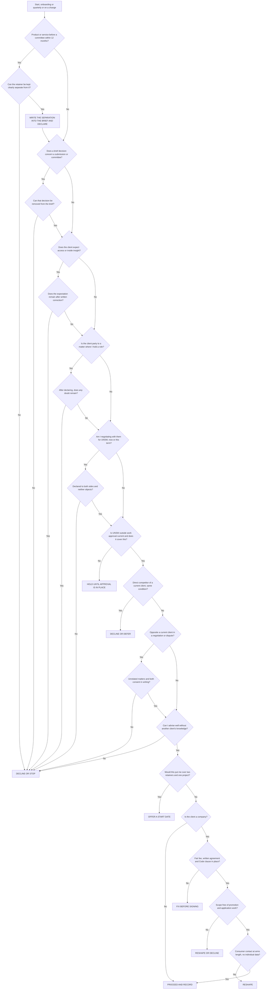

# Ongoing Strategic Advisor: conflict check decision tree

> **What this is:** the standing conflict check as a tree, run at onboarding (before the proposal is sent), at each quarterly review, and whenever something changes. Internal.
> **Fit with the other files:** it follows Parts A to D of `conflict-and-boundaries.md`, section 2, in the same order and with the same answers. That file is the authority; if the two ever differ, that file wins and this one is corrected. The scripts for what I say are in section 3 of that file. Not legal advice. [Lawyer to review with `conflict-and-boundaries.md`.]
> **The rule when unsure:** I step back. The cost of a perceived conflict is larger than the fee from any one retainer.

## How to run it

- Run all four parts every time. A clear result in Part A does not skip Part B.
- Carry a running result. The strictest outcome reached in any part is the outcome of the check: decline or stop overrides everything; defer overrides proceed.
- At onboarding, answer from the fit call and the intake questionnaire (questions 19 to 21). At a quarterly review, ask the three short-form questions first, then run the tree.
- Date it and record it every time, even when nothing has changed.

## The tree

## The same logic as a list

**Part A: the client and public processes**

1. **(A1) Does the client have a product, technology or service that is, or is likely within 12 months to be, before MSAC, PBAC or any committee I sit on or advise?** If no: go to 3. If yes: go to 2.
2. **(A2) Can the retainer be kept clearly separate from that matter: different decisions, different documents, different people where possible?** If no: **DECLINE OR STOP**. If yes: **WRITE THE SEPARATION INTO THE BRIEF AND DECLARE**, then go to 3.
3. **(A3) Do any of the three decisions in the advisory brief concern a submission, an application, or how a committee may respond?** If no: go to 4. If yes: can that decision be removed from the brief and still leave a retainer worth buying? If it cannot: **DECLINE OR STOP**. If it can: remove it, then go to 4.
4. **(A4) Has the client asked for, or do they appear to expect, access to or insight into a public body?** If no: go to 5. If yes: correct it in writing. If the expectation remains: **DECLINE OR STOP**. If it does not: go to 5.
5. **(A5) Is the client party to a matter where I have a decision-making or advisory role in any capacity?** If no: go to 6. If yes: declare to the relevant secretariat and follow their direction. If any doubt remains: **DECLINE OR STOP**. If none: go to 6.

**Part B: my other roles**

6. **(B1) Am I negotiating with this organisation on behalf of UNSW at the moment, or likely to in the term?** If no: go to 7. If yes: declare to both sides before going further. If either objects: **DECLINE OR STOP**. If neither does: go to 7.
7. **(B2) Is UNSW outside-work approval or notification current, and does it cover this retainer?** If no: **HOLD UNTIL APPROVAL IS IN PLACE**. If yes: go to 8.
8. **(B3, B4, B5) Three things to do, none of which stops the check on its own.** Nothing created in my UNSW role and nothing owned by SCN2A Australia is used in the work. If the client has a funding, partnership or sponsorship relationship with SCN2A Australia or Rare Diseases NSW: declare it to the client, consider whether advice could be seen to favour either, and record how it is managed. If my roles require a declaration of this engagement or fee: lodge it and record the date. Go to 9.

**Part C: between clients**

9. **(C1) Is this client a direct competitor of a current retainer or project client in the same condition area?** If yes: **DECLINE OR DEFER**. If no: go to 10. [Kris: confirm this rule.]
10. **(C2) Is this client on the other side of a negotiation, partnership or dispute with a current client?** If no: go to 11. If yes: I act for each only on unrelated matters and only where both consent in writing. If that is not met: **DECLINE OR STOP**. If it is: go to 11.
11. **(C3) Can I advise this client properly without using what I know from another client?** That knowledge is not used. If I cannot advise properly without it: **DECLINE OR STOP**. If I can: go to 12.
12. **(C4) Would taking this client put me over the capacity rule: two retainers and one project?** If yes: **OFFER A START DATE**. If no: go to 13.

**Part D: company clients**

13. **Is the client a pharmaceutical, biotech or medical technology company?** If no: **PROCEED AND RECORD**. If yes: go to 14.
14. **(D1, D2) Is the fee fair market value for the work under a written agreement, and is the Medicines Australia Code clause (proposal template, section 10) in the agreement?** If no to either: **FIX BEFORE SIGNING**, then go to 15. If yes: go to 15.
15. **(D3) Is the scope free of product promotion and of any product-specific application work?** If no: **RESHAPE OR DECLINE**. If yes: go to 16.
16. **(D4) Is consumer contact at arm's length, with no individual consumer data coming to me from the company or going to the company from me?** If no: **RESHAPE**. If yes: **PROCEED AND RECORD**.

*The diagram shows B3 to B5 as part of recording, and shows D1 and D2 as one question. The list is the fuller version.*

## The quarterly re-run: ask first, then run the tree

Asked of the client and recorded, word for word from `conflict-and-boundaries.md`:

1. Has any product, technology or service of yours moved towards an application to a government advisory committee since the last check?
2. Have you entered any new negotiation, partnership or dispute I should know about?
3. Has anything changed in what you want from this retainer?

And asked of myself: have my own roles, employment or other clients changed in a way that affects Parts A to C?

## Named outcomes: what I do

| Outcome | What I do |
|---|---|
| **PROCEED AND RECORD** | Record the date and "no conflict identified" (or "managed as follows", with the text). At onboarding: section 9 of the proposal and the pipeline tracker (conflict_check_done = yes, with the date). Each quarter: section 6 of the quarterly review. Put the date of the next check in the advisory brief. |
| **WRITE THE SEPARATION INTO THE BRIEF AND DECLARE** | Add a boundaries line to the advisory brief naming what is kept apart: which decisions, which documents, which people. Declare to the relevant secretariat where my roles require it and record the date. Tell the client in writing that I will stop any conversation that moves towards the matter. Then continue the check. |
| **HOLD UNTIL APPROVAL IS IN PLACE** | Do not send the proposal, or at a quarterly review do not renew, until UNSW outside-work approval or notification is current and covers the retainer. Tell the client there is an administrative step on my side and give a date. [Kris: location of the approval record.] |
| **FIX BEFORE SIGNING** | Add section 10 of the proposal template to the agreement; confirm the fee is fair market value for the work described and not connected to any product, prescribing or purchasing decision. Do not start until both are done. [Lawyer to confirm wording against the current edition of the Code.] |
| **RESHAPE** | Change the scope so that the company sends me no individual consumer data, I introduce the company to no individual consumers, and documents are de-identified before they reach me. Confirm the change in writing, then finish the check. |
| **RESHAPE OR DECLINE** | Remove the promotional or product-specific element. If what is left is still worth a retainer, finish the check. If not, decline. |
| **OFFER A START DATE** | Offer the first date a place opens. No third retainer and no second project. |
| **DECLINE OR DEFER** | Decline, or defer until the other engagement ends. I do not name the other client or say that there is one in the same area unless that client has consented in writing to being named. Wording: "I am not able to take this on at present. I can revisit it from [date] if that would be useful." |
| **DECLINE OR STOP** | At onboarding: decline in writing the same day. Mid-term: pause the affected work that day, use the script for the situation from `conflict-and-boundaries.md`, section 3, and decide within 5 working days whether to carry on with a written separation, reshape the brief, or end. If I end it: the client pays only for work done to that date; any fee paid in advance for unused time is refunded; documents are returned or deleted within 30 days; the ending email is `emails.md`, 5b. |

## Record of each run

| Date | Occasion (onboarding, quarter 1, quarter 2, change) | Part A result | Part B result | Part C result | Part D result | Overall outcome | Declarations lodged (date) | Recorded in |
|---|---|---|---|---|---|---|---|---|
| [date] | [occasion] | [clear / managed: how / decline] | [text] | [text] | [text or "not a company"] | [outcome name] | [date or "none required"] | [proposal section 9 / quarterly review section 6 / conflict log; pipeline tracker] |

After any event that was not clear: complete the "afterwards, every time" checklist in `conflict-and-boundaries.md`, section 3.
