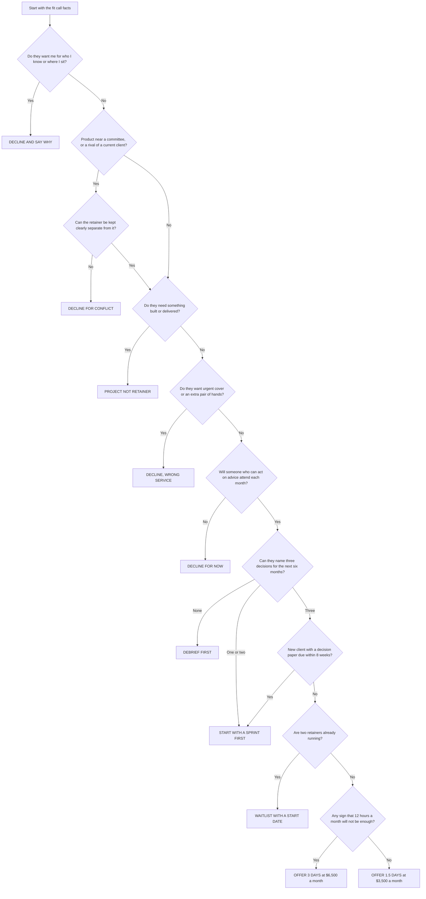

# Ongoing Strategic Advisor: fit decision tree

> **What this is:** whether an organisation should buy a retainer at all, and if so which tier: $3,500 a month for 1.5 days or $6,500 a month for 3 days, six-month minimum. Internal. It turns the fit test in `PRODUCT.md`, section 9, into a tree; it does not change it.
> **When to use it:** during and straight after the 30-minute fit call, before any proposal. The conflict questions here are a first screen. The full standing check is in `conflict-check-decision-tree.md` and `conflict-and-boundaries.md`, and it is run before the proposal is sent.

## The facts to collect on the fit call

| Fact | Question to ask (from `PRODUCT.md`, section 9) | Write it here |
|---|---|---|
| The three decisions | What are the three decisions in the next six months where an outside view would change what you do? | [1, 2, 3, each with an owner and a date] |
| Who attends | Who will be in the monthly session, and can they act on what is discussed? | [names, roles] |
| What they have tried | What have you tried already? | [text] |
| What would end it | What would make you end this after three months? | [text] |
| Conflict screen | Is there any product, application or negotiation I should know about before I run a conflict check? | [text] |
| Why me | What made you think of a retainer, and why now? | [text] |
| Volume | How many documents a month, how many people in sessions, how fast do replies need to be? | [text] |
| History | Have I done a sprint or a design project with them? | [yes: which / no] |

## The tree

## The same logic as a list

1. **Do they want the retainer for who I know or what bodies I sit on?** If yes: **DECLINE AND SAY WHY**. If no: go to 2.
2. **Is there a product, technology or service that is, or is likely within 12 months to be, before MSAC, PBAC or a committee I sit on or advise? Or are they a direct competitor of a current client in the same condition area, or on the other side of a negotiation or dispute with one?** If no to all: go to 4. If yes to any: go to 3.
3. **Can the retainer be kept clearly separate from that matter: different decisions, different documents, different people where possible?** For a competitor or an opposing party, the answer is no unless the rules in `conflict-and-boundaries.md`, Part C, are met. If no: **DECLINE FOR CONFLICT**. If yes: note the separation needed and go to 4.
4. **Do they need something built or delivered: a framework, a plan, a set of sessions, trained staff?** If yes: **PROJECT NOT RETAINER**. If no: go to 5.
5. **Do they want urgent or same-day response, or an extra pair of hands to do the work?** If yes: **DECLINE, WRONG SERVICE**. If no: go to 6.
6. **Will someone senior enough to act on advice attend the monthly session?** If no: **DECLINE FOR NOW**. If yes: go to 7.
7. **How many decisions can they name for the next six months, each with an owner and a date?**
   - None: **DEBRIEF FIRST**.
   - One or two: ask once whether more exist. If they do, and there are three, go to 8. If not, each is better served by a sprint: **START WITH A SPRINT FIRST**.
   - Three: go to 8.
8. **Is this a client I have not worked with before, where the nearest decision needs a written decision paper within 8 weeks?** If yes: **START WITH A SPRINT FIRST**. If no: go to 9.
9. **Are two retainers already running?** If yes: **WAITLIST WITH A START DATE**. If no: go to 10.
10. **Is there any sign that 12 hours a month will not be enough?** Signs: more than 2 documents a month for review, or documents over 20 pages; more than three people in the monthly session; the leadership team or the consumer advisory group chair needs to be in the room; replies needed within 1 working day; a decision likely to be replaced mid-term; a quarterly written summary wanted. If any is true: **OFFER 3 DAYS**. If none: **OFFER 1.5 DAYS**.

## Named outcomes: what I do

| Outcome | What I do |
|---|---|
| **OFFER 1.5 DAYS at $3,500 a month** | Run the full standing conflict check. Fill in `../../assets/proposal-template.md`: offer "Ongoing Strategic Advisor", 1.5 days, six-month term, inclusions from `PRODUCT.md` section 3, exclusions from section 4, and "No consumer participation is planned in this scope, so no consumer payments apply" in section 7. Attach `one-page-agreement-summary.md`. |
| **OFFER 3 DAYS at $6,500 a month** | As above, with the 3-day inclusions. Say which sign from step 10 led to the larger tier, so the client can disagree. A client can start at 1.5 days and move up from the start of any month. |
| **START WITH A SPRINT FIRST** | Quote a Strategic Advisory Sprint ($12,000, four weeks, one decision) from `../03-advisory-sprint/`. Say: "You have one decision with a date. A sprint settles it. If more decisions follow, a retainer makes sense then, and I will know your organisation." Offer the retainer once, at the sprint's final briefing, and only if three decisions are then on the table. |
| **DEBRIEF FIRST** | Offer the CEOF Diagnostic (free) and a Diagnostic Debrief ($1,500). The debrief's action plan names the priorities; the three decisions usually come out of it. Set a date to talk again. |
| **PROJECT NOT RETAINER** | Name the right offer and quote it: a decision paper is a Strategic Advisory Sprint ($12,000); a framework built with consumers is Consumer Engagement Design ($18,000 to $45,000); staff who can run co-design is the in-house training day ($9,500). A retainer can follow the project; it is offered at handover, not before. |
| **DECLINE FOR CONFLICT** | Decline in writing the same day, in two or three sentences. Do not ask for more detail about the product or the other party; the less I hear, the better. Use the independence line. Record the check and the decline in the pipeline tracker. Where the conflict is with a current client, do not say with whom. For a competitor, I may offer to revisit when the other engagement ends. [Kris: confirm the competitor rule.] |
| **DECLINE AND SAY WHY** | Say: "I cannot help on that basis, and I would not if I could. My government advisory appointments are held independently of this practice. Clients receive no access to those bodies or their deliberations." If, once corrected, there is a real need for general engagement advice, restart the tree at step 2. If the expectation remains, the decline stands. |
| **DECLINE, WRONG SERVICE** | Say that the retainer is advice, not delivery and not same-day cover. Suggest hiring or contracting for hands-on work. No referral fee is asked for or taken. |
| **DECLINE FOR NOW** | Say that advice no one can act on is wasted money. Offer to revisit when a decision owner can attend. Note a date in the pipeline tracker. |
| **WAITLIST WITH A START DATE** | Offer the first date a place is expected to open, based on the month-five renewal conversations with current clients. Do not take a third retainer. If the wait is over three months, suggest a sprint in the meantime where there is one decision with a date. If demand continues, the price goes up before days are added. |

## After the tree

- [ ] Outcome and reason recorded in the pipeline tracker.
- [ ] Full standing conflict check run before any proposal (`conflict-check-decision-tree.md`).
- [ ] Between-clients check run before accepting a second retainer.
- [ ] Company clients: section 10 of the proposal template included; fee at fair market value under a written agreement.
