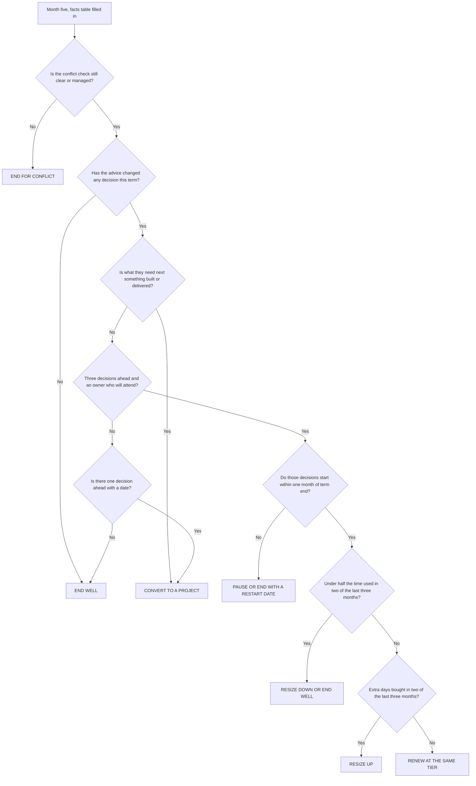

# Ongoing Strategic Advisor: renewal decision tree

> **What this is:** what I recommend at month five of a six-month term: renew at the same tier, resize, convert to a project, pause, or end well. Internal. It supports the renewal email (`emails.md`, 4) and section 5 of `quarterly-review-template.md`; it does not change either.
> **The rule:** I give my recommendation first, with the reason, and the client decides. Renew, resize and stop are on the table every time. A retainer should end on purpose, not drift.

## The facts to collect before using the tree

| Fact | Where it comes from | Write it here |
|---|---|---|
| Status of each of the three decisions | Advisory notes; `decision-log-template.md` | [made / in progress / stalled / dropped] x 3 |
| Decisions changed because of the advice | Decision log; quarterly review, section 1 | [list, or "none"] |
| Hours used in each of months 3, 4 and 5 | `time-and-advice-log.csv` | [x] of [12 / 24], three times |
| Extra days bought in months 3, 4 and 5 | Time log | [number of months] |
| Requests referred out as separate work | Quarterly review, section 2 | [number, and what] |
| Decisions ahead in the following half-year | Asked of the client before the review | [list with owners and dates, or "none yet"] |
| Conflict check re-run | `conflict-check-decision-tree.md` | [date, result] |
| Whether a decision owner still attends | Session records | [yes / no] |

## The tree

## The same logic as a list

1. **Is the standing conflict check, re-run this month, still clear or managed?** If no: **END FOR CONFLICT**. If yes: go to 2.
2. **Has the advice changed any decision this term?** Use the decision log, and ask the client for their own answer. If no: **END WELL**. If yes: go to 3.
3. **Is what the client needs next something built or delivered: a decision paper, a framework, sessions with consumers, trained staff?** If yes: **CONVERT TO A PROJECT**. If no: go to 4.
4. **Can the client name three decisions for the following half-year, each with an owner and a date, and will someone who can act on advice attend each month?** If yes: go to 6. If no: go to 5.
5. **Is there one decision ahead with a date?** If yes: **CONVERT TO A PROJECT** (a sprint). If no: **END WELL**.
6. **Do those decisions become live within one month of the end of the current term?** If no: **PAUSE OR END WITH A RESTART DATE**. If yes: go to 7.
7. **Was under half the included time used in two of the last three months?** If yes: **RESIZE DOWN OR END WELL**. If no: go to 8.
8. **Were extra days bought in two of the last three months?** If yes: **RESIZE UP**. If no: **RENEW AT THE SAME TIER**.

## Named outcomes: what I do

| Outcome | What I do |
|---|---|
| **RENEW AT THE SAME TIER** | Recommend a further six-month term, or month to month with 30 days' notice, at the same fee. Ask the client to bring the next three decisions to the month-six review. Write a new advisory brief (new version number) within 3 working days of the review. Re-run the capacity rule. Send `one-page-agreement-summary.md` again only if a term has changed. |
| **RESIZE UP** | Recommend 3 days at $6,500 a month, from the start of the next month. Say which facts led there: extra days bought, reviews over the limit, the wider team needed in the room. If the client is already on 3 days and still short, the need is a project: go to CONVERT TO A PROJECT for the excess. I do not sell more than 3 days a month. |
| **RESIZE DOWN OR END WELL** | On the 3-day tier: recommend 1.5 days at $3,500 a month, from the start of the next month. On the 1.5-day tier: there is no smaller size, so recommend ending, or month to month if the client has a clear reason to keep a light line open. Say plainly: "I would sooner say this now than have you pay for time you will not use." |
| **CONVERT TO A PROJECT** | Recommend ending the retainer at term and quoting the right offer: a Strategic Advisory Sprint ($12,000) for one decision; Consumer Engagement Design ($18,000 to $45,000) for a framework built with consumers; the co-design training day ($9,500) for staff capability. Run the conflict check for the new scope and check the capacity rule: one project at a time. A retainer and a project for the same client at once is allowed only if the capacity rule still holds. |
| **PAUSE OR END WITH A RESTART DATE** | If the gap is one month or less: use the pause in the agreement, one pause of up to one month in a six-month term, by agreement, with the term extended by the same period. [Kris: confirm the pause rule.] If the gap is longer: end the term properly with a final session and closing note, and offer a restart date. A place is not held during the gap; if both places are taken when the client returns, they are offered a start date. |
| **END WELL** | Recommend stopping, with the reason: the decisions are made, the team no longer needs the outside view, or the advice is not changing decisions. Then follow `PRODUCT.md`, section 11: a final session of the usual length covering what changed, what is unfinished and who owns it, and what to watch in the next six months; a closing note of up to two pages; documents returned or deleted within 30 days; a CEOF Diagnostic re-assessment suggested at 12 months from baseline. Email: `emails.md`, 5a, or 5c where the retainer is not working. Ask for written consent to name the client; no name is used without it. |
| **END FOR CONFLICT** | Do not renew. Follow `conflict-and-boundaries.md`, section 3: the client pays only for work done to the end date; any fee paid in advance for unused time is refunded; documents returned or deleted within 30 days. Email: `emails.md`, 5b. Update declarations where required. |

## Timing

| When | What |
|---|---|
| End of month 4 | If the fee will change at renewal, written notice goes now. The agreement requires 60 days' notice of a price change, and the renewal email at month five is too late to give it before the new term starts. [Kris: confirm how the 60 days is counted against a month-five renewal conversation.] |
| Start of month 5 | Fill in the facts table. Re-run the conflict check. Run this tree. |
| Month 5 | Send the renewal email (`emails.md`, 4) with my recommendation and the reason. |
| Month 6 quarterly review | The client decides. Record the decision, who made it and the date in section 5 of the review. |
| Within 3 working days | Completed review sent; new advisory brief or closing steps started; pipeline tracker updated. |

## Checks before the recommendation is sent

- [ ] The recommendation is the one the facts point to, not the one that keeps the fee.
- [ ] Time lost because I was unavailable is not counted as the client under-using the retainer.
- [ ] The recommendation names the facts behind it, so the client can disagree.
- [ ] Capacity rule checked for any outcome that adds work.
- [ ] Nothing in the renewal email refers to another client or to my public appointments as a reason to continue.
