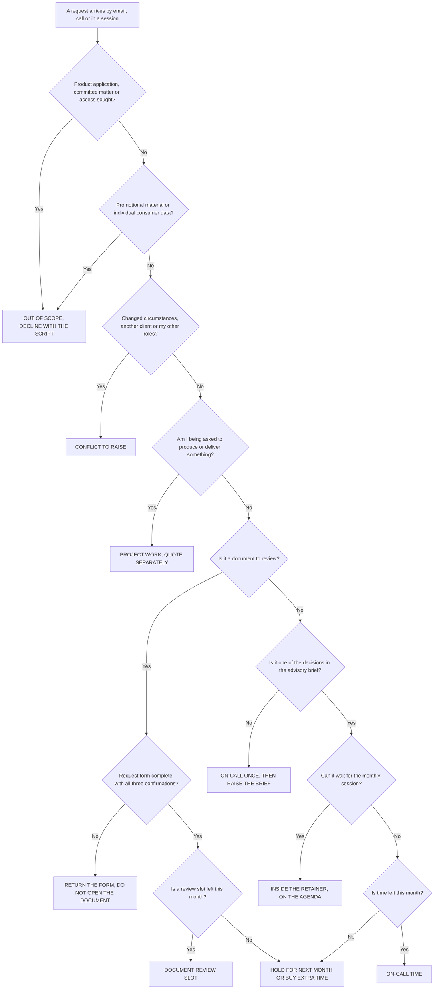

# Ongoing Strategic Advisor: request triage decision tree

> **What this is:** what I do when a retained client asks for something between sessions or in one. Six possible answers: it is inside the retainer; it uses on-call time; it needs a document review slot; it is project work to quote separately; it is out of scope and declined with the script; or it is a conflict to raise. Internal.
> **Fit with the other files:** it puts the three scope tests in `PRODUCT.md`, section 6, behind two boundary checks that come first, because a conflict has to be caught before I hear or read the detail. The scripts are in `conflict-and-boundaries.md`, section 3, and are not rewritten here.
> **The rule:** stop first, then explain, then record. Excess is never billed after the fact.

## The tree

## The same logic as a list

1. **Does the request concern a specific product's application or submission, how a committee may respond, a body I hold an appointment with, or access to or information about any public body?** If yes: **OUT OF SCOPE, DECLINE WITH THE SCRIPT**. Stop the conversation at that point; do not hear the client out first. If no: go to 2.
2. **Is it promotional material, anything naming a product for a promotional purpose, or anything containing information that identifies an individual consumer or patient?** If yes: **OUT OF SCOPE, DECLINE WITH THE SCRIPT**. If no: go to 3.
3. **Does it reveal changed circumstances (a product moving towards an application, a new negotiation, partnership or dispute), or touch another client, UNSW, Rare Diseases NSW or SCN2A Australia?** If yes: **CONFLICT TO RAISE**. If no: go to 4.
4. **Am I being asked to produce or deliver something: write a document, build a framework or plan, run or recruit for sessions with consumers, train staff, speak for the client, or make an introduction?** If yes: **PROJECT WORK, QUOTE SEPARATELY** (or, for representation and introductions, out of scope: see the outcome). If no: go to 5.
5. **Is it a document for me to review and comment on?** If yes: go to 6. If no: go to 8.
6. **Has the document review request form arrived complete, with all three confirmations ticked?** If no: **RETURN THE FORM, DO NOT OPEN THE DOCUMENT**. If a confirmation cannot be ticked, the request goes to **OUT OF SCOPE**. If yes: go to 7.
7. **Is a review slot left this month (2 on the 1.5-day tier, 4 on the 3-day tier), and is the document inside the page limit (20 or 30 pages; longer counts as two)?** If yes: **DOCUMENT REVIEW SLOT**. If no: **HOLD FOR NEXT MONTH OR BUY EXTRA TIME**.
8. **Is it about one of the three decisions in the advisory brief?** If no: **ON-CALL ONCE, THEN RAISE THE BRIEF**. If yes: go to 9.
9. **Can it wait for the next monthly session?** If yes: **INSIDE THE RETAINER, ON THE AGENDA**. If no: go to 10.
10. **Is there time left this month, including any carried over?** If yes: **ON-CALL TIME**. If no: **HOLD FOR NEXT MONTH OR BUY EXTRA TIME**.

## Named outcomes: what I do

| Outcome | What I do | Record |
|---|---|---|
| **INSIDE THE RETAINER, ON THE AGENDA** | Reply: "That belongs in the session on [date]. I have put it first." Add it to the agenda under "The decisions". Ask for any paper 2 working days ahead. | One line in `time-and-advice-log.csv` when the session is logged; advice goes in the monthly advisory note and `decision-log-template.md`. |
| **ON-CALL TIME** | Reply within 2 working days (1.5-day tier) or 1 working day (3-day tier). A call of up to 30 minutes, or a written answer. Say what I think, how sure I am, and what I am inferring. On-call is for advice, not emergencies. | One line in the time log, type "on-call", in quarter hours. If the advice was of substance, one line in the advisory note and the decision log. |
| **ON-CALL ONCE, THEN RAISE THE BRIEF** | Give a short view once. Then say: "This is not one of the three decisions on the brief. I will raise at the next session whether the brief should change." The brief can change at a quarterly review, or once mid-term on the 3-day tier. | Time log, type "on-call"; note "off brief" in the follow-up column; add to the next agenda. |
| **DOCUMENT REVIEW SLOT** | Confirm the return date by reply: 5 working days (1.5-day tier) or 3 working days (3-day tier) from a complete request. Return a review memo of up to 2 pages from `monthly-rhythm.md`, section 4. I comment; I do not rewrite. | Time log, type "review"; review count for the month updated. |
| **RETURN THE FORM, DO NOT OPEN THE DOCUMENT** | Reply the same day: "I have not opened the document. I need the request form completed first, including the three confirmations. The turnaround starts when both have arrived." If the client says a confirmation cannot be ticked, go to out of scope. | No time logged. Note the date in the client folder. |
| **HOLD FOR NEXT MONTH OR BUY EXTRA TIME** | Say: "This month's time is used. I can hold this until [first day of next month], or you can buy extra time: up to one extra day this month at $2,400, agreed in writing before I start." If extra time has been bought two months running, the tier is wrong: recommend moving up or scoping a project. | Agreement to extra time filed before any work. Flag for the quarterly review, section 2. |
| **PROJECT WORK, QUOTE SEPARATELY** | Say: "That is outside what the retainer covers. I can do one of three things: give you a short view now, hold it for the next session, or scope it as a separate piece of work. Which would be most useful?" If they want it built: a decision paper is a Strategic Advisory Sprint ($12,000); a framework or sessions with consumers is Consumer Engagement Design ($18,000 to $45,000); staff training is the co-design training day ($9,500). Check the capacity rule (one project alongside two retainers) and run the conflict check for the new scope. Requests to speak for the client, represent them to government or funders, or make introductions to decision-makers are not project work: they are excluded, and I say so. | Quarterly review, section 3, "Work that should be a project". Pipeline tracker if a proposal is sent. |
| **OUT OF SCOPE, DECLINE WITH THE SCRIPT** | Stop at once. Use the matching script in `conflict-and-boundaries.md`, section 3, word for word: in a session or call ("I need to stop you there..."); for a document ("I have stopped reading this document and deleted my copy..."); for access or inside knowledge ("I cannot help with that, and I would not if I could..."). If a document was opened before I realised: stop reading, delete my copy, reply the same day; it does not count against the month's reviews. Offer the general question if there is one. | Conflict log in the client folder: date, trigger, what I stopped, what I said. A general line in the month's advisory note. Declarations updated where required. |
| **CONFLICT TO RAISE** | Pause the affected retainer work that day. Use the "changed circumstances" script, or the "conflict the client does not know about" script where the matter is on my side. Re-run the standing check within 5 working days using `conflict-check-decision-tree.md`. Come back with one of three outcomes: carry on with a written separation, reshape the advisory brief, or end. Where two clients' interests meet, tell each that a conflict has arisen without saying with whom, and step back from that matter for both. | Conflict log; advisory note in general terms; declarations lodged or updated; pipeline tracker. |

## Two-minute check at the end of every month

From `monthly-rhythm.md`:

1. Did anything this month touch a product, application or committee matter?
2. Did anything I learned from this client bear on another client, or the reverse?

A yes to either goes back through this tree at step 1 or step 3.

## What triage never does

- Hear the detail of an excluded matter "just to understand it".
- Count a refused document against the client's reviews.
- Do the work first and invoice later.
- Stretch "advice" to cover writing the client's document.
- Review a consumer input section of a submission, however general it looks.
