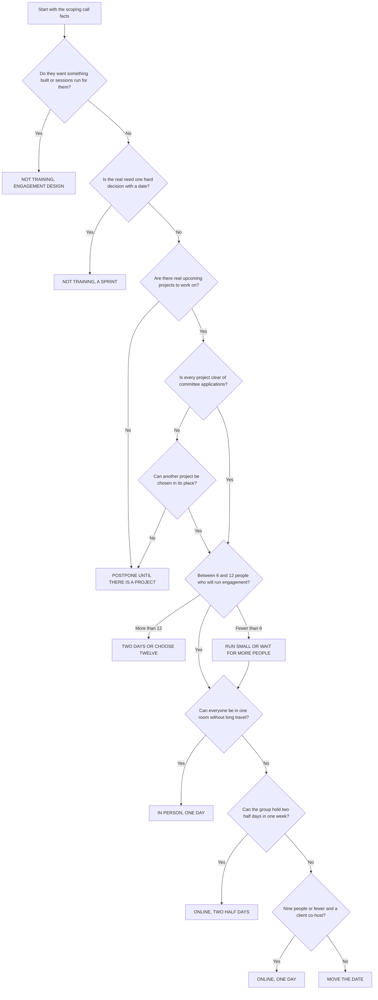
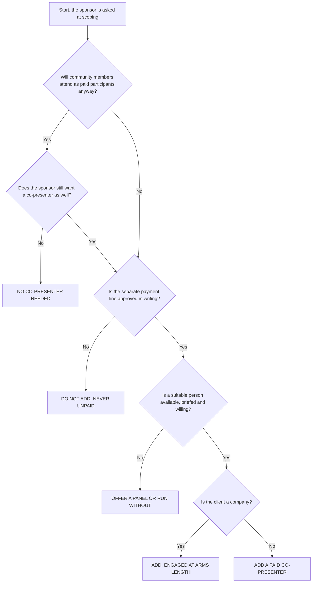

# In-house co-design training: format decision tree

> **What this is:** how I choose the format for a training booking: in person, online in one day, online in two half days, or not training at all because the organisation needs a sprint or an engagement design project. A second, shorter tree decides whether to add a paid community co-presenter. Internal.
> **When to use it:** during and after the 30-minute scoping call (`PRODUCT.md`, section 8), before the quote.
> **Fit with the other files:** `PRODUCT.md`, section 10, defines the online variant as two half days within one week, and says online runs only when travel or geography rules out a room. Online in one day is not defined there. It appears here as a last resort with conditions. [Kris: confirm whether online in one day is offered at all. If not, that outcome becomes "move the date".]

## The facts to collect on the scoping call

| Fact | Write it here |
|---|---|
| Why now, and what should be different in three months | [text] |
| Number of people, and whether they will plan or run engagement in the next six months | [number] |
| Number of real, upcoming projects (up to six) | [number] |
| Whether any project is tied to an application before a committee I sit on or advise | [no / yes: which] |
| Whether someone attending controls a budget | [yes / no] |
| Where people are based, and whether they can be in one room | [text] |
| Whether the group can hold two half days within one week | [yes / no] |
| Whether the client can supply a co-host for an online session | [yes / no] |
| Whether community members in standing roles will attend as participants | [number, or none] |
| Whether a paid community co-presenter or panel is wanted, and whether the cost line is approved | [text] |

## Tree 1: the format

## Tree 1 as a list

1. **Do they want something built for them, or sessions with consumers run for them?** If yes: **NOT TRAINING, ENGAGEMENT DESIGN**. If no: go to 2.
2. **Is the real need one hard decision with a date, not a skill the team lacks?** If yes: **NOT TRAINING, A SPRINT**. If no: go to 3.
3. **Are there real, upcoming projects for participants to work on, in the next six months?** The day is built around them. If no: **POSTPONE UNTIL THERE IS A PROJECT**. If yes: go to 4.
4. **Is every project clear of any application before a committee I sit on or advise?** If yes: go to 6. If no: go to 5.
5. **Can a different project be chosen in its place?** If yes: swap it now and go to 6. If no project remains: **POSTPONE UNTIL THERE IS A PROJECT**.
6. **Are there between 6 and 12 people who will plan or run engagement in the next six months?**
   - More than 12: **TWO DAYS OR CHOOSE TWELVE**.
   - Fewer than 6: **RUN SMALL OR WAIT FOR MORE PEOPLE**; if running small, go to 7.
   - Between 6 and 12: go to 7.
7. **Can everyone be in one room without travel or geography ruling it out?** If yes: **IN PERSON, ONE DAY**. If no: go to 8.
8. **Can the group hold two half days within one week?** If yes: **ONLINE, TWO HALF DAYS**. If no: go to 9.
9. **Are there nine people or fewer, and can the client supply a co-host?** If yes: **ONLINE, ONE DAY**. If no: **MOVE THE DATE**.

## Tree 1 outcomes: what I do

| Outcome | What I do |
|---|---|
| **IN PERSON, ONE DAY** | The default. 9:00 to 4:30 at the client's venue, up to 12 people, run from `run-sheet.md`. Quote $9,500 with `one-page-quote-template.md`. Venue, catering and my travel and accommodation are at cost, agreed in writing in advance. Send `booking-form.md`. |
| **ONLINE, TWO HALF DAYS** | The online default. Two sessions of 9:30 to 1:00 within one week: sessions 1 to 3 on the first, sessions 4 to 7 and commitments on the second, with 20 minutes of work on the recruitment and payment canvas in between. Same price, same outcomes, same workbook, sent as a fillable file five days ahead. Up to 12; 9 is better. A co-host from the client manages the waiting room and chat. No recording. |
| **ONLINE, ONE DAY** | A last resort, used only when the room and the two half days are both ruled out. 9:00 to 4:30 online, with ten minutes' break in every hour, 45 minutes for lunch, and the practice in threes kept in full. Nine people at most. Same price. Tell the sponsor plainly that a full day on screen is harder on people than either other format, and that I recommend the two half days if a second date can be found. [Kris: confirm this format is offered.] |
| **MOVE THE DATE** | Do not compress the day and do not run it for a group that cannot be supported online. Offer two alternative dates for in person, or two pairs of half days. |
| **TWO DAYS OR CHOOSE TWELVE** | Twelve is the limit, because above it not everyone gets feedback. Either the sponsor chooses the 12 people who will run engagement soonest, or the organisation books two separate days, quoted as two fixed-price days. No larger group at a higher price. |
| **RUN SMALL OR WAIT FOR MORE PEOPLE** | Below six the peer work is thin. Say so, and let the sponsor choose: run it, with the spare time used for one-to-one review of session plans; or wait until more staff have projects. The price is the same. |
| **POSTPONE UNTIL THERE IS A PROJECT** | Without a real project the day turns into theory. Postpone, and agree a date to check again. If the team does not know where to start, suggest the CEOF Diagnostic (free) and a Diagnostic Debrief ($1,500). |
| **NOT TRAINING, A SPRINT** | Quote a Strategic Advisory Sprint ($12,000, four weeks, one decision) from `../03-advisory-sprint/`. Training can follow once the decision is made. |
| **NOT TRAINING, ENGAGEMENT DESIGN** | Use `../04-engagement-design/size-decision-tree.md` and quote Consumer Engagement Design ($18,000, $30,000 or $45,000). Reviewing or running participants' own sessions is not part of the training day; that is a design project or a retainer. |

## Tree 2: whether to add a paid community co-presenter

A co-presenter is a community member who presents the afternoon sessions with me, or a panel of two or three who join for a 30-minute conversation. They are always paid, their costs are covered, and the cost is a separate line in the proposal. It is never absorbed in my fee. [Kris: confirm whether this is offered as standard.]

## Tree 2 as a list

1. **Will community members in standing roles (an advisory group chair, a consumer board member) already attend as full, paid participants?** If no: go to 3. If yes: go to 2.
2. **Does the sponsor still want a co-presenter as well?** If no: **NO CO-PRESENTER NEEDED**. If yes: go to 3.
3. **Has the separate payment line been approved in writing?** If no: **DO NOT ADD, NEVER UNPAID**. If yes: go to 4.
4. **Is a suitable person available, willing, and able to be briefed at least a week ahead?** Suitable means experience of being involved in decisions, not only a story to tell. If no: **OFFER A PANEL OR RUN WITHOUT**. If yes: go to 5.
5. **Is the client a pharmaceutical, biotech or medical technology company?** If yes: **ADD, ENGAGED AT ARMS LENGTH**. If no: **ADD A PAID CO-PRESENTER**.

## Tree 2 outcomes: what I do

| Outcome | What I do |
|---|---|
| **ADD A PAID CO-PRESENTER** | Add a separate line to section 7 of the proposal, naming the published schedule. Use `../04-engagement-design/consumer-payment-decision-tree.md` for the rate: the session rate for time in the room, plus paid preparation, plus expenses at cost. [Kris: set the rate for co-presenters; published sitting fees are floors.] Brief the person in a call a week ahead: which sessions (4 to 7), what they will and will not be asked, that they are never required to tell their own story, and that they can step out. Agree in writing how they are introduced. Pay within 14 days. Tell them a payment may affect tax or income support and that I cannot advise on it. |
| **ADD, ENGAGED AT ARMS LENGTH** | As above, with these conditions. The person is engaged and paid through Kris Pierce Consulting at cost with no margin, or through an independent patient organisation, under a written agreement; the company does not select them and holds no payment record for them. No product is named or discussed. The person is told who is funding the day before agreeing. The company receives no personal information beyond what the person chooses to say in the room. [Lawyer to confirm against the current Medicines Australia Code of Conduct.] |
| **OFFER A PANEL OR RUN WITHOUT** | Offer a panel of two or three community members for a 30-minute conversation in session 3 or session 7, each paid, on the same terms. If no one suitable is available, run the day as written. Do not ask a staff member who is also a carer or patient to fill the role. |
| **DO NOT ADD, NEVER UNPAID** | No co-presenter. I do not bring a community member into the room unpaid, and I do not absorb the cost in my fee, because the day teaches that payment is a separate, approved line. Raise it as an example in session 3. |
| **NO CO-PRESENTER NEEDED** | Community members attending as participants are paid for the day by the client and are treated as participants, not as exhibits. They are not asked to present. |
